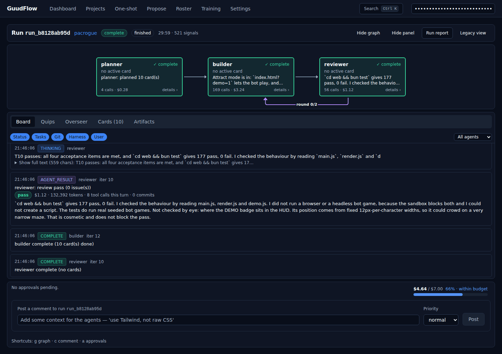
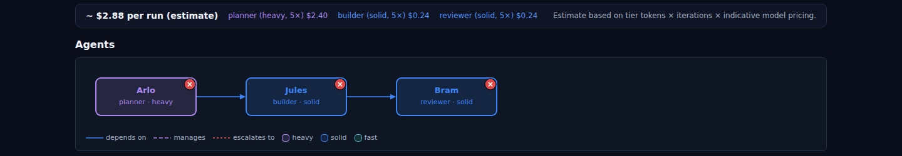
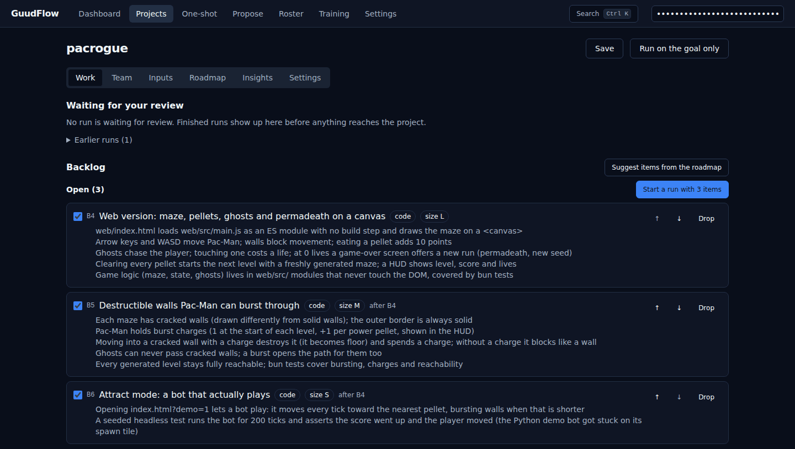
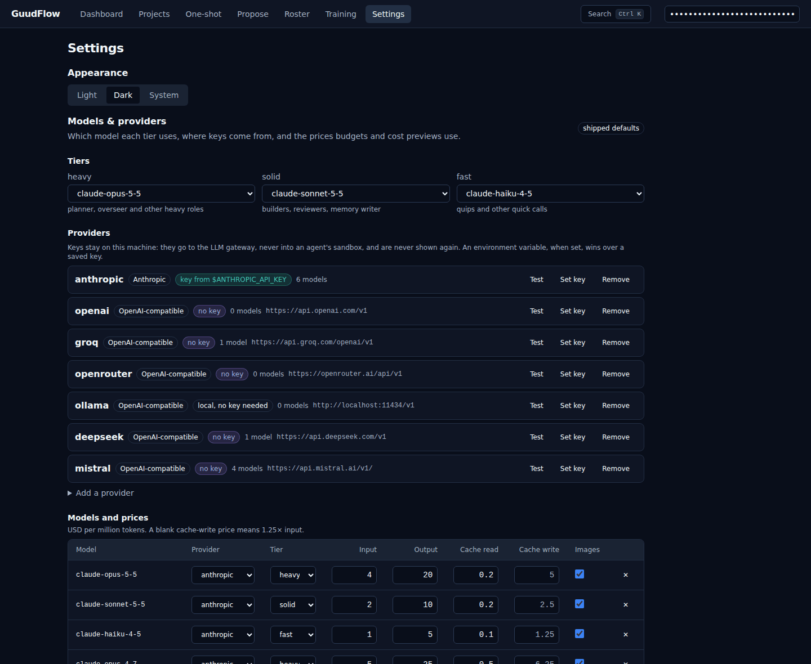

# GuudFlow

**A team of AI agents that works on your software, with you as the manager.**

Describe a goal or pick items from a backlog. GuudFlow proposes a team (a planner, builders and a
reviewer, each with a name), you approve it, and the team gets to work. Each agent runs in its own
sandbox. They share a task board and a git repo, and they review each other's work. Nothing reaches
your project until you accept the run.



---

## What you get

- **A team you approve before anything runs.** You pick the roles, models and capabilities, and see
  a cost estimate up front. Every worker has a name and a role, and they refer to each other by name.

  

- **A live view of each run.** The graph shows who is working on what, what it has cost and where
  the review loop is. Click a worker to see its tool calls, its latest result and what it is allowed
  to do.

  

- **Ongoing work, not one-off runs.** Each project keeps a backlog and its own repo. A run takes
  backlog items, starts from the project's `main`, and waits in **Waiting for your review** until
  you accept it (merged) or reject it (nothing changes).

  

- **Any model, priced properly.** Anthropic, OpenAI-compatible providers and local models (Ollama,
  LM Studio). Each tier (heavy, solid, fast) can use several models. Prices drive budgets and spend
  caps. Keys stay on your machine and never go into a sandbox.

  

- **Guardrails.** Spend caps per role and per run, protected paths, secret scanning before any
  merge, sandboxes with no internet access, and an overseer that steps in when a run gets stuck.

---

## Get started

You need a model API key (Anthropic, or any provider you add in Studio). Choose one of these:

| Your machine | Easiest way | Sandboxed agents? |
|---|---|---|
| Linux with Docker Engine | `docker compose up -d --build` | Yes |
| Windows | Use WSL2 with Docker Engine inside it, then follow the Linux steps | Yes |
| Anything without Docker | Install locally and set `GUUDFLOW_SANDBOX=host` | No (trusted work only) |

**[docs/SETUP.md](docs/SETUP.md) is the full guide.** It covers every option, WSL, keys,
configuration, security and troubleshooting.

### With Docker Compose (Linux)

```bash
git clone https://github.com/Erik-Iuhas/GuudFlow.git && cd GuudFlow
cp .env.example .env            # set GUUDFLOW_API_TOKEN (any long random string)
docker compose up -d --build
```

Open <http://localhost:8000> and paste your token at the top right. Then add your model key under
**Settings → Models & providers**, or set `ANTHROPIC_API_KEY` in `.env`.

### Installed locally (Python 3.11+, Node 18+, git)

```bash
./scripts/setup.sh              # venv, Python deps, .env  (Windows without WSL: ./scripts/setup.ps1)
scripts/install_opencode.sh     # the pinned agent runtime
(cd studio && npm install && npm run build)

source venv/bin/activate
GUUDFLOW_STUDIO_DIST=studio/dist uvicorn api.main:app --port 8000
```

Open <http://localhost:8000>. Without Docker, add `GUUDFLOW_SANDBOX=host` to `.env`. Agents then
run as plain processes on your machine, so use it only for work you trust.

### Your first run

1. **Projects → New project.** Write the goal. Add a `README.md` under **Inputs** if you have a spec.
2. On the **Work** tab, add a few backlog items. Put one acceptance check per line.
3. Tick the items and click **Start a run**. Approve the proposed team.
4. Watch the run. Post a comment at any time if you want to steer it.
5. When it finishes, review the diff under **Waiting for your review**, then accept or reject it.

[docs/SETUP.md §6](docs/SETUP.md#6-first-project-end-to-end) walks through this in more detail.

---

## Other ways to drive it

**Command line:** a one-shot run with a default team.

```bash
python -m cli.oneshot "Build a typed Python client for the Open-Meteo API with tests" \
    --budget 5 --demo           # --demo auto-approves the team; --sandbox auto|docker|host
```

**API / CI:** add a backlog item, start a run with it, and accept the result.

```bash
H=(-H "Authorization: Bearer $GUUDFLOW_API_TOKEN" -H "Content-Type: application/json")
curl -X POST localhost:8000/api/projects/my-app/backlog "${H[@]}" \
  -d '{"title": "Rate-limit login", "acceptance": ["429 after 5 tries"]}'
curl -X POST localhost:8000/api/invoke/my-app "${H[@]}" -d '{"confirm": true, "backlog_items": "top"}'
curl -X POST localhost:8000/api/projects/my-app/runs-review/RUN_ID/accept "${H[@]}"
```

Invoke routes return `202` straight away with a status URL to poll.

**Per-project settings** (**Settings → Project work**):

- **Check command:** run on each finished run before you review it, for example `bun test`.
- **Real remote:** synced before each run. An accepted run is pushed as a branch or opened as a pull
  request.
- **Autopilot:** runs on a schedule within per-run and weekly budgets.

---

## How it works

GuudFlow is the manager. It runs the scheduler, the task board, personas and memory, permissions,
credentials, merges and the Studio UI. Each agent role is a headless
[opencode](https://github.com/anomalyco/opencode) server in its own sandbox, on its own git branch.

- **Keys stay on the host.** Agents reach models through an LLM gateway on the host, which holds the
  real keys and gives each role a virtual key with a spend cap.
- **Tools that need the outside world run on the host.** Web search, screenshots, package installs
  and board tools go through GuudFlow's MCP server.
- **Structured results.** Agents finish each turn with a validated result.
- **The runner merges.** It checks each role's branch (protected paths, symlinks, secrets) and
  merges it into the run's `main`.
- **Review loop and overseer.** Review is a loop between builder and reviewer with a round limit. A
  heavy-tier overseer wakes when deterministic detectors see the run stalling.

More detail:

- [docs/ARCHITECTURE.md](docs/ARCHITECTURE.md): diagrams of the components, the turn lifecycle,
  the sandbox network and how cards move.
- [docs/OPENCODE_HARNESS_PLAN.md](docs/OPENCODE_HARNESS_PLAN.md): the design.
- [DESIGN.md](DESIGN.md): the original intent and rationale.
- [ROADMAP.md](ROADMAP.md): what's next.
- [CHANGELOG.md](CHANGELOG.md): what is in each release and its known limits.

## Configuration

These environment variables matter most. The full list is in
[docs/SETUP.md §8](docs/SETUP.md#8-configuration-reference).

| Variable | Default | What it does |
|---|---|---|
| `ANTHROPIC_API_KEY` | unset | Model key. You can also paste keys in Studio; an env var wins |
| `GUUDFLOW_API_TOKEN` | unset | Bearer token for the API and Studio. Required in production |
| `GUUDFLOW_SANDBOX` | `auto` | `auto` (Docker if available, else host), `docker`, or `host` (no isolation) |
| `GUUDFLOW_ENV` | unset | `production` refuses host mode (Docker required) |
| `GUUDFLOW_DATA_DIR` | `./data` | Projects, runs, personas, model config |
| `GUUDFLOW_STUDIO_DIST` | unset | Serve the built Studio from the API on one port |

## Project layout

```
core/        scheduler, runner, project repo, backlog, autopilot, model config
  harness/   opencode harness: runs, task board, overseer, MCP server, host tools
gateway/     LLM gateway: virtual keys, spend caps, cost log
api/         FastAPI app, routes, WebSocket
worker/      job runner, sandbox manager
studio/      React + Vite frontend
sandbox/     agent sandbox images
agents/      personas, memory, host-side agents (meta-agent, memory writer)
cli/         python -m cli.oneshot
data/        shipped defaults (models, personas, example projects); runtime data goes here too
tests/       pytest suite (no real LLM calls)
docs/        setup guide, architecture, design plans
```

## Tests

```bash
pytest                           # backend; mocked LLMs, no key needed
cd studio && npm run typecheck && npm test
```

Tests that need Docker or the opencode binary skip cleanly when either is missing.

## License

[Apache License 2.0](LICENSE).
