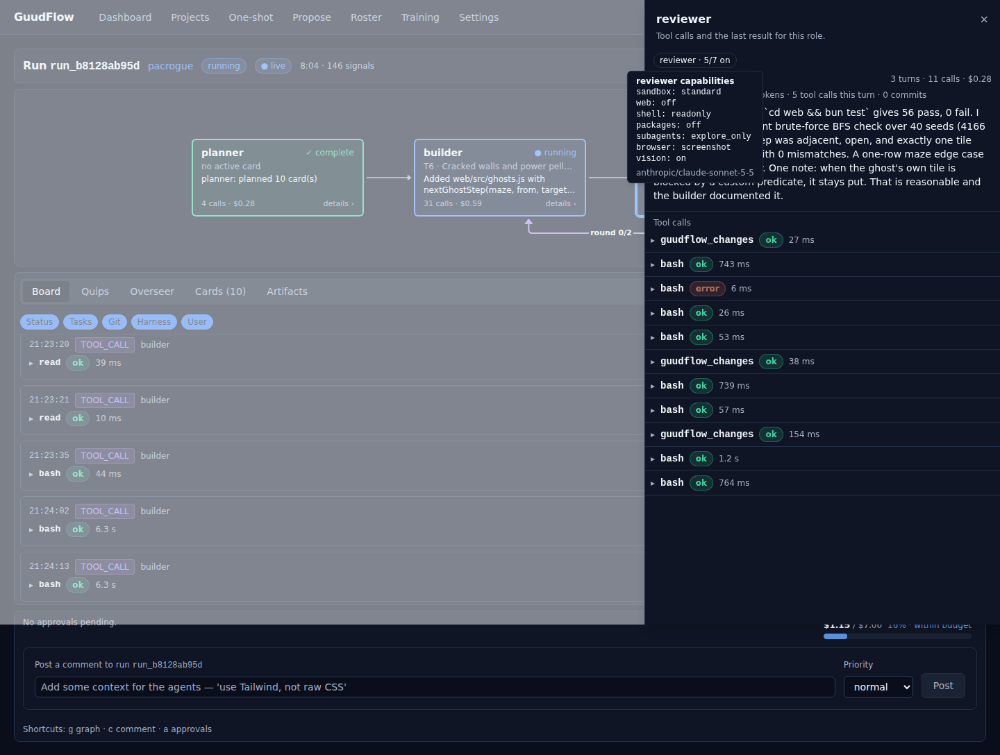

# GuudFlow

**A team of AI agents that works on your software, with you as the manager.**

Describe a goal or pick items from a backlog. GuudFlow proposes a team (a planner, builders and a
reviewer, each with a name), you approve it, and the team gets to work. Each agent runs in its own
sandbox. They share a task board and a git repo, and they review each other's work. Nothing reaches
your project until you accept the run.


---

## What you get

- **A team you approve before anything runs.** You pick the roles, models and capabilities, and see
  a cost estimate up front. Every worker has a name and a role, and they refer to each other by name.

  

- **A live view of each run.** The graph shows who is working on what, what it has cost and where
  the review loop is. Click a worker to see its tool calls, its latest result and what it is allowed
  to do.

  

- **Ongoing work, not one-off runs.** Each project keeps a backlog and its own repo. A run takes
  backlog items, starts from the project's `main`, and waits in **Waiting for your review** until
  you accept it (merged) or reject it (nothing changes).

  

- **Any model, priced properly.** Anthropic, OpenAI-compatible providers and local models (Ollama,
  LM Studio). Each tier (heavy, solid, fast) can use several models. Prices drive budgets and spend
  caps. Keys stay on your machine and never go into a sandbox.

  

- **Guardrails.** Spend caps per role and per run, protected paths, secret scanning before any
  merge, sandboxes with no internet access, and an overseer that steps in when a run gets stuck.

---

## Before you start

The laundry list. `scripts/doctor.sh` checks all of it and tells you what to fix.

**Always**
- [ ] **A model API key**: Anthropic, or any OpenAI-compatible provider or local model you add in
      Studio. You can paste it in Studio after starting, so it does not have to be in a file.
- [ ] **An API token** you make up: any long random string (`openssl rand -hex 24`). It protects the
      API and Studio. It goes in `.env` as `GUUDFLOW_API_TOKEN`.
- [ ] **git** (any recent version).
- [ ] **Free port 8000** (Studio dev server uses 3001).
- [ ] **A budget in mind.** Runs spend real money. Set per-run and weekly caps before the first run.

**For the Docker path**
- [ ] **Docker Engine** on Linux, or on Windows inside WSL2. Docker Desktop cannot host the
      sandboxes. The Compose file also needs `/var/run/docker.sock` and `NET_ADMIN`.
- [ ] A few GB of disk for the image and per-run containers.

**For the uv / Python path**
- [ ] **[uv](https://docs.astral.sh/uv/)** installs the Python packages, and Python itself if you
      lack 3.11+ (see [Installing uv](#installing-uv)).
- [ ] **Node 18+ and npm**, to build Studio once.
- [ ] **Docker Engine** if you want sandboxed agents. Without it, set `GUUDFLOW_SANDBOX=host` (agents
      then run as your user, so use it only for work you trust).

**Optional**
- [ ] `BRAVE_API_KEY` or `TAVILY_API_KEY` for the researcher role's web search.
- [ ] `GUUDFLOW_GIT_TOKEN` to push accepted runs to a real remote.
- [ ] `GUUDFLOW_CA_BUNDLE` if your network uses its own certificate authority ([SETUP §9](docs/SETUP.md)).
- [ ] Playwright Chromium for screenshots (setup installs it; `GUUDFLOW_SKIP_PLAYWRIGHT=1` skips it).

### Installing uv

| Platform | Command |
|---|---|
| Linux, macOS, WSL | `curl -LsSf https://astral.sh/uv/install.sh \| sh` |
| macOS (Homebrew) | `brew install uv` |
| Windows (PowerShell) | `powershell -ExecutionPolicy ByPass -c "irm https://astral.sh/uv/install.ps1 \| iex"` |
| Any (pipx or pip) | `pipx install uv` or `pip install uv` |

`scripts/install_uv.sh` (or the VS Code task **Install uv**) does the Linux/WSL one and skips if uv exists; the GuudFlow scripts find uv on their own afterwards. Open a new terminal afterwards in other shells so `uv` is on your `PATH`, then check with `uv --version`. No
Python 3.11 on the machine is fine: `uv venv` downloads one. Details: <https://docs.astral.sh/uv/getting-started/installation/>.

## Get started

Pick one. Both end at <http://localhost:8000>, where you paste your token at the top right and add
your model key under **Settings → Models & providers**.

### A. Docker Compose (the easy one, with full sandboxing)

```bash
git clone https://github.com/Erik-Iuhas/GuudFlow.git && cd GuudFlow
cp .env.example .env            # set GUUDFLOW_API_TOKEN (openssl rand -hex 24); ANTHROPIC_API_KEY is optional here
docker compose up -d --build
docker compose logs -f          # wait for "Application startup complete"
```

Stop with `docker compose down`. Your data stays in `./data` (set `GUUDFLOW_HOST_DATA` to move it).
Update with `git pull && docker compose up -d --build`.

### B. uv and Python (no container for the app)

```bash
git clone https://github.com/Erik-Iuhas/GuudFlow.git && cd GuudFlow
scripts/setup.sh                # venv + packages via uv, Chromium, Studio packages, .env, seed data
scripts/install_opencode.sh     # the pinned agent runtime into .tools/opencode
scripts/build.sh studio         # build Studio into studio/dist
$EDITOR .env                    # set GUUDFLOW_API_TOKEN (and GUUDFLOW_SANDBOX=host if no Docker)
scripts/doctor.sh               # tells you if anything is still missing

source venv/bin/activate
GUUDFLOW_STUDIO_DIST=studio/dist uvicorn api.main:app --port 8000
```

By hand, without the scripts: `uv venv venv && uv pip install -r requirements.txt`, then
`python -m playwright install chromium` (with the venv active) and `cd studio && npm ci && npm run build`.
On Windows, see [Running modes](#running-modes).

For development, `scripts/dev.sh` starts the API with reload on :8000 and the Studio dev server on
:3001. Use `scripts/dev.sh --no-reload` while agents are running, so a code edit does not restart
the worker under them.

[docs/SETUP.md](docs/SETUP.md) is the full guide: WSL, keys, configuration, security and
troubleshooting.

---

## Running modes

Pick the row that matches your machine, then follow its steps. Every VS Code task and script goes
through one entry point (`bash scripts/run.sh <task>`, or `scripts/run.ps1 <task>` on Windows), so
the task names are the same everywhere: **Install uv**, **Setup**, **Doctor**, **Run dev stack**,
**Stop dev stack**, **Build…**, **Check…**.

**Quickest start, any machine:** run the VS Code task **Prepare this machine** (or
`bash scripts/run.sh prepare`). It detects Linux, macOS or WSL (and warns if the folder is on the
slow Windows disk), whether Docker Engine can host sandboxes, and whether npm can reach its registry.
It then installs uv, runs setup, gets Studio (a `studio-dist.tar.gz` you put in `prebuilt/` first,
with no npm at all; else an npm build; else the release download), sets `GUUDFLOW_SANDBOX=host` when there is no usable Docker, generates
`GUUDFLOW_API_TOKEN` if it is empty, runs doctor and says what to do next. Re-run it any time; it
skips what is done. With `GUUDFLOW_WINDOWS_MODE=native` it does the native-Windows version.

| Mode | Use it when | Agent sandboxes |
|---|---|---|
| **Docker Compose** | You only want to use GuudFlow, on Linux or in WSL2 with Docker Engine | Yes |
| **Linux / macOS, native** | You develop GuudFlow on Linux or a Mac | Yes with Docker Engine, else host mode |
| **WSL2 (recommended on Windows)** | You are on Windows | Yes with Docker Engine inside WSL, else host mode |
| **Windows VS Code, forwarding to WSL** | You open the folder from Windows VS Code | Same as WSL |
| **Windows native** | No WSL at all | No: host mode only, trusted work only |

### Docker Compose
1. `cp .env.example .env` and set `GUUDFLOW_API_TOKEN`.
2. `docker compose up -d --build` (or the task **Docker Compose up**). Logs: **Docker Compose logs**.
3. Open <http://localhost:8000>, paste the token, add a model key in Settings.

### Linux / macOS, native
1. Install uv (**Install uv**, or `bash scripts/run.sh install-uv`) and Node 18+.
2. **Setup** (`bash scripts/run.sh setup`): venv and packages with uv, Chromium, Studio packages,
   opencode, `.env`, seed data.
3. Edit `.env`: `GUUDFLOW_API_TOKEN`; add `GUUDFLOW_SANDBOX=host` if you have no Docker.
4. **Doctor**, then **Run dev stack** (API :8000, Studio :3001). Use **Run dev stack (no reload)**
   while agents are running.

### WSL2 (recommended on Windows)
1. In a WSL terminal, clone into the Linux file system: `cd ~ && git clone … && cd GuudFlow`.
   Do not work from `/mnt/c/...` (see quirks).
2. Open it with `code .` (VS Code connects through the **WSL** extension).
3. Follow the Linux steps. Studio opens in your Windows browser at <http://localhost:3001>.
4. For sandboxes, install Docker Engine inside the WSL distro (not Docker Desktop).

### Windows VS Code, forwarding to WSL
If you open the folder from Windows (a `C:\…` folder or `\\wsl.localhost\…`), the tasks run
`scripts/run.ps1`, which forwards each task into WSL with `wsl.exe --cd <folder>`. Same steps as WSL;
WSL must be installed. This is the default (`GUUDFLOW_WINDOWS_MODE=wsl`).

### Windows native
1. Set `GUUDFLOW_WINDOWS_MODE=native` (environment, or a line in `.env`) and `GUUDFLOW_SANDBOX=host`.
2. Install uv (**Install uv** runs the PowerShell installer) and Node 18+.
3. Run **Prepare this machine**: uv, `setup.ps1` (uv when installed, else pip), opencode, Studio
   (a `studio-dist.tar.gz` you put in `prebuilt\` first, else an npm build), `GUUDFLOW_SANDBOX=host` and a token
   in `.env`, then doctor.
4. Every task has a native version: **Run dev stack** (`dev.ps1`: separate windows for the API
   and Studio; it serves the prebuilt Studio on :8000 when npm packages are missing), **Stop dev
   stack**, **Doctor**, **Build** (studio, opencode, native; docker if Docker is installed),
   **Check** (backend, studio), the **Studio:** tasks, and `scripts\run.ps1 api`. Only the sandbox
   image and the escape suite need Linux.
5. Scripts are plain ASCII so Windows PowerShell 5.1 reads them correctly; PowerShell 7 works too.

### Quirks to look out for
- **`/mnt/c` is slow and drops execute bits.** A project under the Windows disk in WSL makes every
  install and every agent start slow, and copied scripts lose their execute bit. Tasks start
  scripts with `bash`, so they still run, but clone into `~/` for speed.
- **First agent start can be slow.** Each agent's opencode server must answer within 180 s
  (`GUUDFLOW_OPENCODE_STARTUP_S`). If a run shows `turn crashed: opencode serve not healthy`, the
  error includes the end of opencode's log; raise the timeout on slow disks.
- **Docker Desktop cannot host sandboxes.** Use Docker Engine (Linux, or inside WSL2), or host mode.
- **Host mode has no isolation.** Agents run as your user. Fine for trusted demos, not for untrusted
  goals.
- **npm packages unavailable (proxy, mirror missing a version).** Studio is the only part that needs
  npm. The installer (`bash scripts/run.sh studio-deps`) retries, falls back from the exact
  lockfile versions to any version `package.json` allows, and uses `GUUDFLOW_NPM_REGISTRY` for a
  company mirror. If npm still fails, skip it with a prebuilt Studio (static files, the same on
  every OS). **Put the archive in `prebuilt/`** (`studio-dist.tar.gz`, or the GitHub Actions artifact
  zip `studio-dist-tar-gz.zip` as downloaded) and run **Prepare this machine**. Prepare, Setup and
  Run dev stack all go through one Studio step (`bash scripts/run.sh studio-ensure`, task **Studio:
  use the prebuilt archive in prebuilt/**) that checks `prebuilt/` first and then never runs npm.
  The **Studio bundle** GitHub Action builds the archive on every push to `main` (artifact
  `studio-dist-tar-gz`, release `studio-latest`); **Studio: download the prebuilt build**
  (`studio-fetch`, needs `GITHUB_TOKEN` for a private repo) saves it into `prebuilt/` for you, and
  Prepare tries that on its own when npm fails. A machine with npm can make one with
  `bash scripts/run.sh studio-pack`. **Run dev stack** then serves it from the API on :8000
  instead of the dev server on :3001.
- **WSL sees Windows programs.** WSL adds the Windows `PATH`, so a Windows npm or Python can run
  inside WSL and fail with "'vite' is not recognized". Tasks remove those folders
  (`GUUDFLOW_KEEP_WINDOWS_PATH=1` to keep them) and use only Linux tools; with no Linux Node,
  Studio comes from `prebuilt/`. A `studio/node_modules` installed from Windows is not used in WSL.
- **Python packages behind a proxy.** One step makes `./venv` and installs the packages for every
  task: **Python environment** (`bash scripts/run.sh python-env`, `scripts\run.ps1 python-env`).
  Run it on its own first when setup trips; it says what failed. It uses `HTTPS_PROXY`, trusts
  the system certificate store (and `GUUDFLOW_CA_BUNDLE`), takes a PyPI mirror in
  `GUUDFLOW_PIP_INDEX`, and an installed Python in `GUUDFLOW_PYTHON` so uv does not download one.
  With no PyPI at all, download the **Python wheels** Action's artifact for your machine
  (`python-wheels-windows-py311`, or `-linux-` for Linux and WSL), put the zip in `prebuilt/` and
  run it again: it installs with no network.
- **A proxy or company certificate.** Put `GUUDFLOW_CA_BUNDLE=<your CA's PEM file>` (and
  `HTTPS_PROXY` if needed) in `.env`: the API and every setup task read it from there (a
  `C:\...` path works in WSL too). TLS checks
  stay on ([SETUP §9](docs/SETUP.md)).
- **Restart after editing `.env`.** The API reads it at start. After installing uv, open a new
  terminal (the scripts find it either way).
- **Port 3001 already in use.** Studio's dev server will not move to another port; run **Stop dev
  stack**, then start again.
- **Code edits restart the API** in the reload mode, cancelling running agents. Use the no-reload
  task during runs.
- **Line endings.** `.gitattributes` keeps scripts LF. If you copied files rather than cloning and see
  `$'\r': command not found`, re-clone, or run `sed -i 's/\r$//' scripts/*.sh`.
- **Something did not start?** Open the run's **Console** tab: it shows why each role never started
  or crashed, and each agent's server log.

---

## Working on GuudFlow

| Script | What it does |
|---|---|
| `scripts/doctor.sh` | Checks tools, Docker, `.env`, built pieces and the port |
| `scripts/setup.sh` | First-time install (packages via uv) |
| `scripts/dev.sh [--no-reload]` | API on :8000 and Studio dev server on :3001 |
| `scripts/stop.sh` | Stops them (also the VS Code task **Stop dev stack**) |
| `scripts/build.sh native\|docker\|studio\|opencode\|sandbox` | `native` = Studio + opencode for the Python path; `docker` = the Compose image (builds its own, independent of the others) |
| `scripts/check.sh [backend\|studio\|escape]` | Tests: pytest, Studio typecheck and vitest, or the sandbox escape suite |

Run `scripts/check.sh escape` too when you touch `core/harness/`, `worker/`, `sandbox/` or `gateway/`.

Which entry point a task uses on your machine is explained in [Running modes](#running-modes).

**VS Code:** run **Tasks: Run Task**. The tasks in `.vscode/tasks.json` cover
setup, doctor, the dev stack, Compose up/logs/down, builds, and each check. `.vscode/launch.json` debugs the API, the current pytest file, and a one-shot run.
Run **Tasks: Run Test Task** for the fast checks.

---

### Your first run

1. **Projects → New project.** Write the goal. Add a `README.md` under **Inputs** if you have a spec.
2. On the **Work** tab, add a few backlog items. Put one acceptance check per line.
3. Tick the items and click **Start a run**. Approve the proposed team.
4. Watch the run. Post a comment at any time if you want to steer it.
5. When it finishes, review the diff under **Waiting for your review**, then accept or reject it.

[docs/SETUP.md §6](docs/SETUP.md#6-first-project-end-to-end) walks through this in more detail.

---

## Other ways to drive it

**Command line:** a one-shot run with a default team.

```bash
python -m cli.oneshot "Build a typed Python client for the Open-Meteo API with tests" \
    --budget 5 --demo           # --demo auto-approves the team; --sandbox auto|docker|host
```

**API / CI:** add a backlog item, start a run with it, and accept the result.

```bash
H=(-H "Authorization: Bearer $GUUDFLOW_API_TOKEN" -H "Content-Type: application/json")
curl -X POST localhost:8000/api/projects/my-app/backlog "${H[@]}" \
  -d '{"title": "Rate-limit login", "acceptance": ["429 after 5 tries"]}'
curl -X POST localhost:8000/api/invoke/my-app "${H[@]}" -d '{"confirm": true, "backlog_items": "top"}'
curl -X POST localhost:8000/api/projects/my-app/runs-review/RUN_ID/accept "${H[@]}"
```

Invoke routes return `202` straight away with a status URL to poll.

**Per-project settings** (**Settings → Project work**):

- **Check command:** run on each finished run before you review it, for example `bun test`.
- **Real remote:** synced before each run. An accepted run is pushed as a branch or opened as a pull
  request.
- **Autopilot:** runs on a schedule within per-run and weekly budgets.

---

## How it works

GuudFlow is the manager. It runs the scheduler, the task board, personas and memory, permissions,
credentials, merges and the Studio UI. Each agent role is a headless
[opencode](https://github.com/anomalyco/opencode) server in its own sandbox, on its own git branch.

- **Keys stay on the host.** Agents reach models through an LLM gateway on the host, which holds the
  real keys and gives each role a virtual key with a spend cap.
- **Tools that need the outside world run on the host.** Web search, screenshots, package installs
  and board tools go through GuudFlow's MCP server.
- **Structured results.** Agents finish each turn with a validated result.
- **The runner merges.** It checks each role's branch (protected paths, symlinks, secrets) and
  merges it into the run's `main`.
- **Review loop and overseer.** Review is a loop between builder and reviewer with a round limit. A
  heavy-tier overseer wakes when deterministic detectors see the run stalling.

More detail:

- [docs/ARCHITECTURE.md](docs/ARCHITECTURE.md): diagrams of the components, the turn lifecycle,
  the sandbox network and how cards move.
- [docs/OPENCODE_HARNESS_PLAN.md](docs/OPENCODE_HARNESS_PLAN.md): the design.
- [DESIGN.md](DESIGN.md): the original intent and rationale.
- [ROADMAP.md](ROADMAP.md): what's next.
- [CHANGELOG.md](CHANGELOG.md): what is in each release and its known limits.

## Configuration

These environment variables matter most. The full list is in
[docs/SETUP.md §8](docs/SETUP.md#8-configuration-reference).

| Variable | Default | What it does |
|---|---|---|
| `ANTHROPIC_API_KEY` | unset | Model key. You can also paste keys in Studio; an env var wins |
| `GUUDFLOW_API_TOKEN` | unset | Bearer token for the API and Studio. Required in production |
| `GUUDFLOW_SANDBOX` | `auto` | `auto` (Docker if available, else host), `docker`, or `host` (no isolation) |
| `GUUDFLOW_ENV` | unset | `production` refuses host mode (Docker required) |
| `GUUDFLOW_DATA_DIR` | `./data` | Projects, runs, personas, model config |
| `GUUDFLOW_STUDIO_DIST` | unset | Serve the built Studio from the API on one port |
| `GUUDFLOW_WINDOWS_MODE` | `wsl` | Windows only: tasks forward to WSL, or `native` runs the PowerShell scripts |
| `GUUDFLOW_OPENCODE_STARTUP_S` | `180` | Seconds each agent's opencode server may take to start |
| `GUUDFLOW_CA_BUNDLE` | unset | Extra CA certificate (PEM) to trust, for proxies and internal endpoints |

## Project layout

```
core/        scheduler, runner, project repo, backlog, autopilot, model config
  harness/   opencode harness: runs, task board, overseer, MCP server, host tools
gateway/     LLM gateway: virtual keys, spend caps, cost log
api/         FastAPI app, routes, WebSocket
worker/      job runner, sandbox manager
studio/      React + Vite frontend
sandbox/     agent sandbox images
agents/      personas, memory, host-side agents (meta-agent, memory writer)
cli/         python -m cli.oneshot
data/        shipped defaults (models, personas, example projects); runtime data goes here too
tests/       pytest suite (no real LLM calls)
docs/        setup guide, architecture, design plans
```

## Tests

```bash
pytest                           # backend; mocked LLMs, no key needed
cd studio && npm run typecheck && npm test
```

Tests that need Docker or the opencode binary skip cleanly when either is missing.

## License

[Apache License 2.0](LICENSE).
