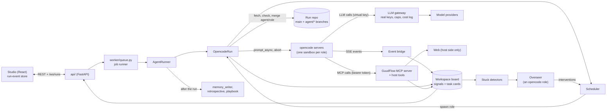
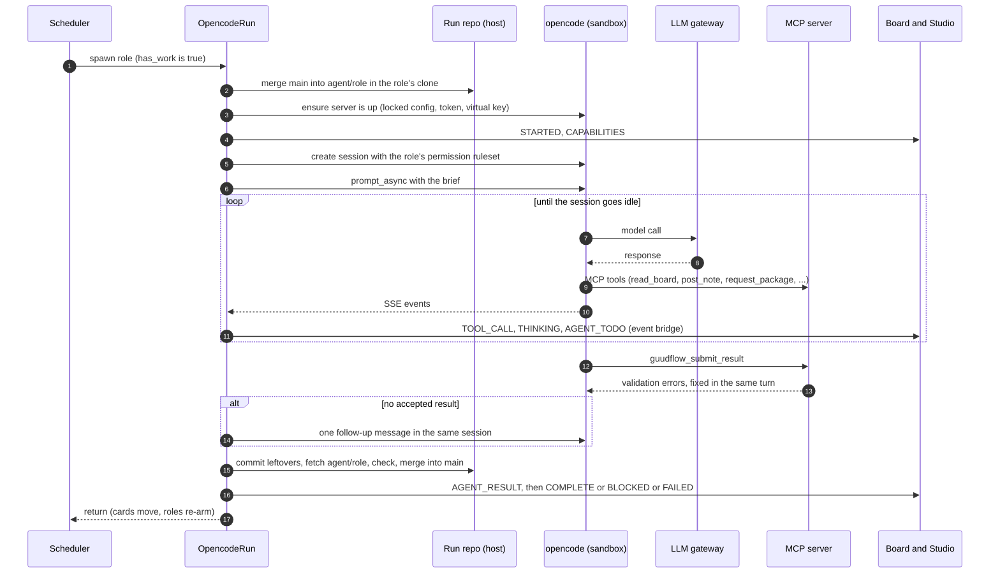
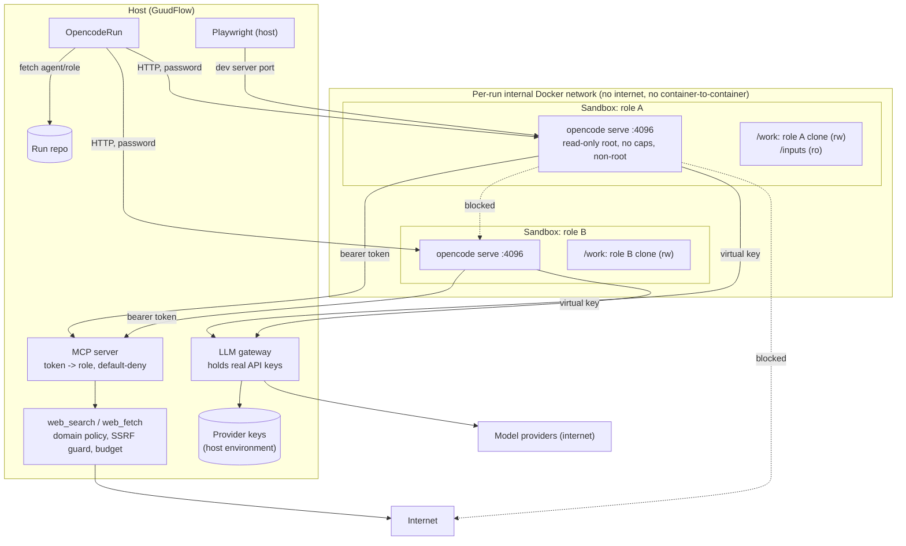
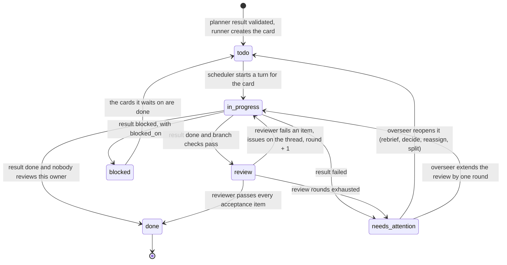

# GuudFlow — Architecture Overview

> This is the **current-state** map of the system. It is meant to be read
> first, before `DESIGN.md`. The design doc is still the canonical
> specification of intent, but several layers and flows have been
> refactored since it was written; this overview points to the diagrams
> that reflect what actually exists in the repo.
>
> **Two harnesses.** Agent work now runs on [opencode](https://github.com/anomalyco/opencode)
> in sandboxes. That is the default harness and the first part of this
> document. The original in-process agent loop (`harness: "legacy"`) still
> exists until its retirement task (work breakdown S15) lands; diagrams
> 03 to 05, 07 and 11 and the refactor log describe that legacy harness.

For high-level context, see [`README.md`](../README.md). For the full
intent + rationale, see [`DESIGN.md`](../DESIGN.md). For deviations from
the original design, see the [refactor log](#refactor-log) below.

> **Diagram format.** The legacy diagrams in `docs/diagrams/` are **ASCII
> art** (box-drawing characters + plain arrows) so they render cleanly on
> phones, terminals, and plain-text viewers. The opencode harness diagrams
> below are **Mermaid** blocks, which GitHub and most markdown viewers
> render; the same facts are also given in the tables next to each one.

---

## Opencode harness (default)

Design source: [`OPENCODE_HARNESS_PLAN.md`](OPENCODE_HARNESS_PLAN.md). Task list and
status: [`OPENCODE_WORK_BREAKDOWN.md`](OPENCODE_WORK_BREAKDOWN.md). Studio:
[`STUDIO_UI_SPEC.md`](STUDIO_UI_SPEC.md). Summary in
[`DESIGN.md` section 39](../DESIGN.md#39-opencode-harness).

GuudFlow is the manager: it decides who runs when, with which permissions, and records what
happened. opencode does the agent work. One `opencode serve` (pinned 1.18.34) runs per role, in its
own sandbox, working in its own git clone.

### Components

| Component | Where | Job |
|---|---|---|
| Runner | `core/runner.py` (`AgentRunner`) | Run setup (workspace, run repo, persisters, quips); hands the run to `OpencodeRun` when `project.harness == "opencode"`; runs `memory_writer` and the retrospective afterwards |
| `OpencodeRun` | `core/harness/run.py` | Builds the role table, starts the MCP server and gateway, executes one turn per spawn, merges branches |
| Scheduler | `core/scheduler.py` | Unchanged class. Decides when to spawn: dependencies, joins, review edges (`request_rework`), blocking (`block`), parking, `max_parallel`, `has_work`, a watchdog hook |
| opencode servers | sandbox containers, or host processes in `host_dev` mode | The tool loop, edits, shell, LSP, compaction, provider retries |
| Sandbox manager | `worker/sandbox_manager.py`, `sandbox/agent-opencode.Dockerfile` | Hardened container per role, one internal network per run |
| LLM gateway | `gateway/app.py` | Holds the real provider keys, issues per-(run, role) virtual keys, enforces model allow-list and spend caps, writes the cost log |
| GuudFlow MCP server | `core/harness/mcp_server.py` | The only way an agent talks back: `submit_result`, `post_note`, `read_board`, `report_progress`, `ask_human`, `request_visual_feedback`, `request_package`, git `changes` / `history`; the role comes from the bearer token |
| Host tools | `core/harness/mcp_web.py`, `mcp_browser.py`, `mcp_visual.py` | `web_search` / `web_fetch`, Playwright `screenshot`, `visual_diff`; granted per role |
| Event bridge | `core/harness/event_bridge.py` | opencode SSE events become board signals (`TOOL_CALL`, `THINKING`, `AGENT_TODO`, ...) |
| Approval gate | `core/harness/approvals.py` | Answers `permission.asked`: sticky "always", project allow-list, else a human |
| Task board | `core/harness/task_board.py`, `task_flow.py`, `tasks.py` | Cards from the planner's validated plan; column moves on scheduler events only |
| Overseer and detectors | `core/harness/detectors.py`, `overseer.py`, `overseer_flow.py` | Stuck detectors wake the overseer; the scheduler applies its interventions |
| Retrospective and playbook | `core/harness/retrospective.py`, `core/playbook.py` | End-of-run retrospective, per-project playbook, carry-forward brief |
| Git roles | `core/harness/git_roles.py` | Per-role checkouts, runner-side fetch, checks and merge |
| Artifact registry | `core/harness/artifacts.py` | Indexes images, SVG, PDF and HTML an agent produced; `ARTIFACT` signals |
| Capabilities | `core/harness/capabilities.py`, `permissions.py`, `config_gen.py` | Per-role toggles compiled to the opencode ruleset, container profile and MCP grants; the generated opencode config |
| One-shot | `core/oneshot.py`, `cli/oneshot.py`, `api/routes/oneshot.py` | One goal, default team (`data/teams/default_oneshot.json`), 202 from the API |
| Studio event store | `studio/src/stores/runEvents.ts`, `runEvents.gen.ts` | One typed run-event store fed by `/ws/runs/{id}` |

### Data flow



Reading it: the scheduler owns concurrency and decides *when* a role spawns. `OpencodeRun`
executes the spawn. Everything an agent does is visible on the board because the event bridge and the
MCP server write signals; agents never write signals or touch each other. The overseer is itself an
opencode role, woken by detectors that run in the scheduler, and its decisions are applied by the
scheduler.

### Turn lifecycle

One spawn is one opencode session and one validated structured result.



| Step | Detail |
|---|---|
| Brief | Only what opencode cannot know: goal, the card with its checklist and thread, upstream results, notes, review issues. Untrusted content is delimited |
| Result | `AgentResult`, `ReviewResult`, `PlanResult` or `OverseerResult`, validated with Pydantic inside the MCP tool |
| Failure | One retry, then `FAILED` with the validation error; with the task board on, a bad card turn sends the card to needs attention instead of failing the role |
| Branch checks | Only `agent/{role}` moved; no protected paths (`inputs/`, `.github/`, `opencode.json`, `.opencode/`, `.guudflow/`); no symlinks out of the repo; `core/secret_scan.py` passes |
| Limits | Per-turn wall clock aborts the session; opencode `steps`; `doom_loop: deny`; gateway spend caps |

### Sandbox and network layout

Each run gets one Docker network that is `internal` with inter-container traffic disabled. Sandboxes
can reach exactly two services, both on the host and bound to the network's gateway IP.



| Rule | Where it is enforced |
|---|---|
| A sandbox reaches only the gateway and the MCP server (and only their ports) | Internal network plus host port rules (`SandboxManager.restrict_host_ports`) |
| No sandbox reaches another sandbox or the internet, not even DNS | Network settings; verified by the escape suite |
| Real provider keys never enter a container | The container environment is built from scratch; the gateway swaps in the real key |
| The host drives the sandbox | Host to container works (prompting, abort, screenshots of the role's dev server) |
| Web access is host-side | `web_search` / `web_fetch` run in the MCP server; opencode's own `webfetch` / `websearch` are denied |
| Container hardening | Read-only root, `cap_drop ALL`, `no-new-privileges`, memory 1 GB, pid and cpu limits, tmpfs for `/tmp` and home, gVisor (`runsc`) when available |
| Host mode | `sandbox: host_dev` / `--sandbox host` runs opencode as a host process with a warning on every spawn; refused when `GUUDFLOW_ENV=production` |

### Card flow

The task board is the work queue. Only scheduler-side events move a card. Humans can add a card, change
priority and comment (through `/api/runs/{id}/cards`), but never change a column.



| Column | Who moves a card there | Event |
|---|---|---|
| to do | Runner / scheduler side | Card created from the validated plan; returned from blocked when its dependencies finish; reopened by an overseer intervention (applied by the run, not by the overseer itself) |
| in progress | Scheduler | Turn starts for the card, or rework after a failed review |
| review | Scheduler | Author's result is `done` and the branch passed its checks |
| done | Scheduler | Reviewer passes every acceptance item (or no reviewer for that owner) |
| blocked | Scheduler | Result `blocked`; an "unblock" card is made for the role it waits on |
| needs attention | Scheduler | Result `failed` or review rounds exhausted; wakes the overseer |

Cards carry a thread of typed entries (`note`, `blocked_on`, `review_issue`, `decision`,
`intervention`, `human_comment`, `artifact`), and every brief includes the thread of its card.
Built-in guards: files-overlap serialisation, one active card per role, a cap on the review column,
card aging as a stuck detector.

### After the run

`memory_writer` records persona episodes and patterns from the run's opencode transcripts and card
threads. Then `finalize_run()` writes a retrospective (cost per role, review rounds, interventions and
whether they worked, stall minutes), a conservative playbook diff for
`data/projects/{id}/playbook.json`, and a carry-forward brief for continuation runs. Nothing from the
playbook is applied to a team without human approval.

### Running it

See the "Run the demo" section of the [README](../README.md): `python -m cli.oneshot "..." --demo`,
`POST /api/oneshot`, `scripts/install_opencode.sh`, and `scripts/run_quality_gate.sh` for the offline
quality gate on a finished run.

---

## How GuudFlow runs

A run goes through six big phases. Each phase has at least one diagram. The
phase names hold for both harnesses; under opencode, phase 4 is "scheduler ·
opencode turns · review edges · overseer" (see the diagrams above), and the
diagram links below describe the legacy harness.

```
   ┌──────────────┐    ┌──────────────┐    ┌──────────────┐
   │ 1 · Propose  │───►│ 2 · Approve  │───►│ 3 · Init     │
   │ meta-agent + │    │ user signs   │    │ seed         │
   │ roster       │    │ off team     │    │ workspace +  │
   │              │    │              │    │ git +        │
   │              │    │              │    │ personas     │
   └──────────────┘    └──────────────┘    └──────┬───────┘
                                                   │
                       ┌──────────────┐    ┌───────▼──────┐
                       │ 6 · Synth.   │◄───│ 5 · Merge    │
                       │ memory_writer│    │ branches →   │
                       │ + reputation │    │ main on      │
                       └──────────────┘    │ APPROVED     │
                                           └──────▲───────┘
                                                  │
                                           ┌──────┴────────────────┐
                                           │ 4 · Loop              │
                                           │ scheduler · agents ·  │
                                           │ reviews · overseer    │
                                           └───────────────────────┘
```

| Phase | Diagrams |
|-------|----------|
| 1 — Propose / 2 — Approve | [`06`](diagrams/06-sequence-run-lifecycle.md) |
| 3 — Init | [`10`](diagrams/10-deployment-and-data-flow.md) |
| 4 — Loop | [`02`](diagrams/02-component-architecture.md), [`06`](diagrams/06-sequence-run-lifecycle.md), [`07`](diagrams/07-sequence-handshake-and-escalation.md), [`09`](diagrams/09-state-agent-and-run.md) |
| 5 — Merge | [`06`](diagrams/06-sequence-run-lifecycle.md), [`09`](diagrams/09-state-agent-and-run.md) |
| 6 — Synthesize | [`08`](diagrams/08-sequence-persona-memory.md) |

---

## Diagram index

Diagrams 01 to 11 are **ASCII art** so they render anywhere. They were drawn
before the opencode harness: 01, 02, 06, 08, 09 and 10 are still broadly right
for run phases, personas and deployment, while 03, 04, 05, 07 and 11 describe
the legacy agent loop (`BaseAgent`, tool catalog, ASK/ANSWER, 12-layer prompt).
The opencode harness diagrams are the Mermaid blocks in
[Opencode harness (default)](#opencode-harness-default) above.

| # | Title | What it answers |
|---|-------|-----------------|
| 01 | [System Context](diagrams/01-system-context.md) | What is GuudFlow as a black box? Who talks to it? |
| 02 | [Component Architecture](diagrams/02-component-architecture.md) | What are the layers and the legal arrows between them? |
| 03 | [Class — `core/`](diagrams/03-class-core.md) | The orchestration kernel. `Workspace`, `Scheduler`, `AgentRunner`, signals, protocol. |
| 04 | [Class — `agents/`](diagrams/04-class-agents.md) | `BaseAgent`, archetypes, builtin agents, `Persona`. |
| 05 | [Class — Tools + LLM](diagrams/05-class-tools-and-llm.md) | Tool hierarchy, `ToolManifest`, `LLMClient`, `ModelRegistry`, error taxonomy. |
| 06 | [Sequence — Run Lifecycle](diagrams/06-sequence-run-lifecycle.md) | Goal-to-deliverable, plus rejection / pause / resume / training variants. |
| 07 | [Sequence — Handshake + Escalation](diagrams/07-sequence-handshake-and-escalation.md) | ASK/ANSWER + REQUEST_SKIP + reviewer-rejection escalation. |
| 08 | [Sequence — Persona Memory](diagrams/08-sequence-persona-memory.md) | Memory injection, post-run synthesis, lifecycle states. |
| 09 | [State — Agent + Run](diagrams/09-state-agent-and-run.md) | The two FSMs the scheduler reasons about. |
| 10 | [Deployment + Data Flow](diagrams/10-deployment-and-data-flow.md) | Local dev, docker compose, on-disk run layout. |
| 11 | [Prompt Stack](diagrams/11-prompt-stack.md) | The 12-layer system prompt, cache boundary, where each layer is set (legacy harness; opencode roles use `core/harness/persona_prompt.py`). |
| — | [Opencode harness](#opencode-harness-default) | Components, data flow, turn lifecycle, sandbox and network layout, card flow (Mermaid, in this file). |

---

## Quick map: file → diagram(s)

| If you are reading… | …start with diagram |
|---|---|
| `core/scheduler.py` | 03, 06, 07, 09; the data-flow and card-flow diagrams above |
| `core/harness/*` | the opencode harness section above |
| `gateway/*`, `worker/sandbox_manager.py` | the sandbox and network diagram above |
| `cli/oneshot.py`, `core/oneshot.py`, `api/routes/oneshot.py` | the data-flow diagram above |
| `core/runner.py` | 03, 06, 07, 09, 11 |
| `core/workspace.py` / `signals.py` / `protocol.py` | 03, 06 |
| `core/credentials_broker.py` / `tool_manifest.py` | 02, 05 |
| `core/llm/*` | 02, 05 |
| `agents/base.py` | 04, 05, 11 |
| `agents/persona.py` / `persona_desk.py` / `persona_chat.py` | 04, 08 |
| `agents/builtin/*` | 04, 06, 07 |
| `agents/tools/*` | 05 |
| `api/*` | 02, 06 |
| `worker/*` | 02, 10 |

---

## Refactor log

Notable deviations from the originally-written `DESIGN.md`. The design
doc is still the right place for *intent*; this log captures *what
changed in the code* so the diagrams above make sense. Entries below the
opencode one describe the legacy harness unless they say otherwise.

### Opencode harness (see [`OPENCODE_HARNESS_PLAN.md`](OPENCODE_HARNESS_PLAN.md))

- Agent work runs on opencode, one sandboxed server per role, behind
  `harness: "opencode"` (the default for new and stored projects).
  `harness: "legacy"` keeps the old loop until work breakdown task S15
  retires it.
- New packages: `core/harness/` (runner, client, event bridge,
  capabilities, permissions, results, task board, detectors, overseer,
  git roles, artifacts, host MCP tools), `gateway/` (LLM gateway),
  `worker/sandbox_manager.py` and `sandbox/agent-opencode.Dockerfile`,
  `core/playbook.py`, `core/oneshot.py` + `cli/oneshot.py`,
  `api/routes/{oneshot,cards,harness}.py`, `tests/harness/`,
  `tests/quality/`.
- Completion contract: structured results via the MCP tool
  `guudflow_submit_result`, replacing `[COMMIT]` / `[VERIFY]` / `[ASK]`.
- No synchronous peer ASK. Notes on cards plus `blocked_on`;
  `Scheduler.block()` re-arms the role that must act.
- Review is a scheduler edge (`Scheduler.request_rework`, `max_review_rounds`).
- The task board is the work queue; only the scheduler moves cards.
- The overseer replaces the tech lead; stuck detectors wake it.
- File claims are dropped; each role has its own clone and branch.
- Hard constraints 13, 18, 19, 20 and the protocol rules changed
  (see CLAUDE.md, marked "changed for the opencode harness").

### M1 — Handshake protocol & roster awareness (commit `1ec92e4`)

- Added structured `ASK / ANSWER / REQUEST_SKIP / SKIP_GRANTED /
  SKIP_DENIED / STORY_OPENED / STORY_CLOSED` to `core/protocol.py`.
- `Scheduler.interrupt()` / `resume()` is the one parking mechanism for
  hard pauses, peer waits, and skip-confirmations. `ask_human()` and
  `request_visual_feedback()` were migrated onto it.
- `PEER_TIMEOUT` and `SKIP_TIMEOUT` signals + a deadline watcher.
- Story lifecycle on the workspace (`Workspace.stories`,
  `Workspace.active_story`).
- Layer 3.5 (teammate brief) and Layer 5.5 (protocol voice) added to
  `effective_system_prompt`.
- `core/edit_blocks.py` introduced for SEARCH/REPLACE edit-block syntax
  with closest-match hint on miss.

### M2 — Persona desk, manifesto layer, history tracking (commit `d4516f0`)

- `agents/persona_desk.py` — `DeskIndex` parses YAML-fronted markdown
  from `data/role_templates/{role}/desk/`, serves contextual snippets.
- New tools: `desk-search`, `desk-push`.
- Layer 3.6 (manifesto) injected into the system prompt. Default lives
  at `data/manifestos/default.md`; per-project overrides supported.
- `memory_writer` now appends to `history.json` after every run with
  atomic write + 1000-entry rotation to `history.archive.jsonl`.
- Run initializer materializes `desk_seeds` and writes
  `inputs/README.md`.

### M3 — Multi-model abstraction + error taxonomy + caching (commit `7b1c54f`)

- `core/llm.py` split into `core/llm/` package: `client.py`, `errors.py`,
  `anthropic.py`, `openai.py`, `registry.py`. All public symbols
  re-exported for backwards compatibility.
- New error taxonomy (`RateLimitError`, `AuthError`,
  `ContextLengthError`, `InvalidRequestError`, `ServerError`,
  `NetworkError`, `TimeoutError`) with provider exception mapping.
- `AnthropicLLMClient` gained `cache_system=True` so the stable system
  prompt is wrapped with `cache_control: ephemeral`.
- `LLMResponse` gained `cache_read_tokens` / `cache_creation_tokens`.
- `ModelRegistry` reads `data/models.json` (5 models across Anthropic,
  Groq, DeepSeek + 6 providers). Per-tier resolution, deprecation
  warnings, per-provider client cache. Local endpoints (Ollama, LM
  Studio) treated as available without an API key.
- `MemoryWriter` is now wired through a SOLID-tier client by default.
- Cost estimator pulls per-1k rates from the registry (75/25 input/output
  blend) with static fallback.
- `GET /api/models` exposes the catalog to studio dropdowns and the
  cost estimator.

### Autonomy enforcement + inter-agent board messaging (commit `d2cdfb1`)

- New `AGENT_MESSAGE` signal type for non-blocking directed
  agent-to-agent messages.
- New `board-message` tool — agents post to a named peer; the recipient
  reads the message at the start of its next turn.
- New mandatory `AUTONOMY RULES` block in `effective_system_prompt`
  ("START WORKING NOW. Make at least one tool call. Never present
  options to humans for things you can decide.").
- Tightened task prompt: "call `fs-list` or `git-changed-files` as your
  very first tool call."

### Reviewer file-by-file process (commit `41c26d4`)

- `git-diff` accepts an optional `path` argument and is hard-capped at
  ~6000 chars (~1500 tokens) per call — no more 429s on large
  codebases.
- New `git-changed-files` tool added to `BASELINE_LOCAL_SCOPES` and
  `Reviewer.default_tools`.
- `CodeReviewer` system prompt rewritten to enforce the
  list-then-iterate review process.

### Hyphenated tool names + RBAC scopes (commit `0709f1b`)

- Tool names are hyphenated (`fs-write`, `git-diff`, `code-exec`,
  `desk-search`). RBAC scope strings match 1:1.

### Phase G-prime — Resume after crash (commits `44c40b6`, `fef6f1a`, `4818135`, `3a8f8db`)

- `Workspace._board_persister` writes signals incrementally to
  `data/runs/{run_id}/board.jsonl`.
- `core/run_loader.py::restore_workspace` rebuilds a `Workspace` from
  the persisted board + artifacts; `derive_agent_states` infers state
  from signal history.
- `POST /api/runs/{id}/resume` plus a worker resume path that picks up
  the restored workspace.

### Phase F — Training Camp + persona chat + memory synthesis

Several commits in the F-series:

- `core/training/scenario.py` and `tournament.py` —
  scenarios, rubrics, tournaments, ranking.
- `agents/builtin/rubric_scorer.py` — replaces a human reviewer in
  training mode.
- `agents/persona_chat.py` — `POST /api/personas/{id}/chat` for
  one-off consultation.
- `MemoryWriter` upgraded with LLM-driven pattern distillation
  (`F.3.0/F.3.1`), pattern flip detection (`F.3.2`), and deterministic
  style drift (`F.3.3`).

### Phase K — Project roadmap context

Layer 3.8 of the system prompt — `data/projects/{id}/roadmap.md` is
loaded and injected so each run is aware of the project's larger arc
(continuous app building).

### M3.5 — Task desks + planner pickup (commits `a501574`–`4aef259`)

- `core/workspace.py`: `Task` + `TaskRef` dataclasses; `Workspace.tasks`
  dict + `task_queues` per-role list; `add_task`, `mutate_task`.
- `core/runner.py`: `_handle_task_closures` (closes tasks on `closes:`
  in COMMIT), `_maybe_auto_start_task` (marks next pending task
  IN_PROGRESS), `_handle_user_comment_routing` (drops USER_COMMENT on
  planner's desk when mention detected), planner pickup loop.
- `GET /api/runs/{id}/desks` — reads live workspace or falls back to
  persisted `tasks.jsonl`.
- `worker/job_runner.py::serialise_task` — canonical Task → dict.

### Track 7 — Subtask decomposition (commits `89a3bff`, `6050e34`, `7af5fab`)

- New `decompose-task` tool (`agents/tools/decompose_task.py`). Cheap
  smart-parent gate uses an LLM to reject coupled subtask sets — keeps
  agents from forking unrelated work into a chain that doesn't parallelise.
- `assign-task` accepts subtasks atomically, so the parent task and its
  children land in one call.
- `Workspace.active_subtask: dict[str, str]` records which subtask each
  role is currently advancing.
- Runner advances `active_subtask` automatically when a subtask closes
  (`_handle_task_closures` keys off `closes:` trailers in COMMIT messages).
- New prompt **Layer 4.7 — ACTIVE SUBTASK** in `effective_system_prompt`
  injects the current subtask so the agent stays focused.

### Track 8 — Subtask context hot-swap + recall (commit `dfa8958`)

- New `recall-subtask` tool (`agents/tools/recall_subtask.py`) — per-
  subtask scoped memory recall instead of global persona memory.
- Layer 4.5b (task-relevant files) is rebuilt when the active subtask
  changes, so the prompt swaps the relevance window automatically.

### Track 9 — Protocol cleaner sidecar (commit `f4c2710`)

- New `PROTOCOL_CLEANUP_AUTO` signal type. The runner watches for
  `PROTOCOL_PARSE_FAIL` and auto-fires a cheap `protocol-cleanup`
  sub-LLM call that re-renders the malformed trailing block instead of
  re-prompting the whole agent.
- New `ProtocolCleanupTool` in `agents/tools/llm_dispatch.py`,
  registered as a Track-12 sub-LLM use case.

### Track 11 — Workers cognition view (commit `e450535`)

- New `WorkerCognitionView` component (`studio/src/components/`) — live
  per-agent snapshot showing the current iteration, last tool call
  summary, recall hits, and budget. Wires into the existing
  `RunWsContext`.
- `BaseAgent._summarise_tool_result` produces the ≤120-char one-liner
  the panel displays.

### Track 12 — Sub-LLM dispatch (commit `dfa8958`)

- `LlmDispatchTool` base + concrete `SummariseSubtaskTool`,
  `ProtocolCleanupTool` in `agents/tools/llm_dispatch.py`.
- `ProjectConfig.sub_llm_models: dict[use_case, model_id]` and
  `AgentConfig.sub_llm_models_override` per-use-case overrides; both
  fall back to `ModelRegistry.cheapest_tool_capable()` at dispatch time.
- Used internally by Track 8 (subtask summarisation) and Track 9
  (protocol cleanup) — kept off the main reasoning model to save spend.

### Track 1 — Iteration metrics + cost tracking

- `Workspace.iteration_metrics: list[IterationMetrics]` — one row per
  full `BaseAgent.run()` invocation, with input/output tokens, cache
  hit/creation tokens, recall counts, repo-map / relevant-files /
  diff token breakdown.
- `Workspace.context_log: list[ContextSnapshot]` — per-`get_context()`
  budget vs. used.
- Track 3d.5: `IterationMetrics.estimated_cost_usd` populated from
  `ModelRegistry.cost_per_1k`. `RunAnalytics` view shows a live cost
  column.
- `Workspace.add_iteration_metrics()` and persistence hooks dump
  `iteration_metrics.jsonl`, `agent_turns.jsonl`,
  `llm_calls.jsonl`, `context_log.jsonl` per run.

### ask-peer wrapper (commits `ee0c7f2`, `7e8aa68`, `20ebecb`, `753840a`)

- New `ask-peer` tool (`agents/tools/ask_peer.py`) — a discoverable
  wrapper around the M1 `[ASK]` protocol. Most agents would never
  guess the raw protocol path; the tool gives them an obvious one.
- `board-message` (the non-blocking sibling) was tightened: priority
  demoted, question-shaped messages to completed agents are now
  rejected to stop "ASK cascades".
- `_generic_peer_answer` runs in a bounded tool-use loop so the
  responder can read 1–2 files before answering, with a fallback
  synthesised ANSWER if the budget elapses.

### Hierarchy: `manages` + `escalates_to` (commits `abd0ee4`, `919bbba`)

- `AgentConfig.manages: list[str]` — explicit "I dispatch to these
  roles" list. Replaces the old derived-from-RBAC behaviour.
- `AgentConfig.escalates_to: list[str]` — explicit escalation handler
  list (defaults to `tech_lead` when empty).
- New conditional **Layer 6.7 — DISPATCH RULE** in
  `effective_system_prompt`: only injected when an agent has
  `assign-task` AND `manages` lists ≥ 2 teammates. Forces "one
  `assign-task` per teammate" — fixes the architect anti-pattern of
  bundling all downstream work into a single dev's task.

### CONTEXT BEFORE OUTPUT layer (commit `0b2b4f0`)

- New **Layer 6.6** in `effective_system_prompt` after the autonomy
  block: "read every reference in your task brief; inventory before
  reads; arch describes shape, design describes behaviour — both
  required before code lands." Diagnosed in `run_f741ea78ba` where
  devs read 3 architecture docs but skipped 26 design docs and wrote
  `ghost_ai_system.py` without reading `ghost_ai.md`.

### Tool-call-adverse runtime fixes (commits `b04105f`, `2841f9b`, `efedf9f`, `242fedc`, `696c483`, `561f9a8`)

- `max_tokens` default bumped 4096 → 8192 across `LLMClient`,
  `AnthropicClient`, `BaseAgent`.
- `fs-write-append` chunked-write primitive for files larger than
  `max_tokens` of output.
- `fs_batch.py`: `FsWriteBatch` and `FsEditBatch` with per-file +
  per-batch byte caps so the LLM picks the right tool.
- Runner handles `stop_reason == "max_tokens"` by recovering truncated
  batched tool calls (and salvaging text-as-tool patterns).
- Cleanup model rejects kind-mismatch (specialist VERIFY loop).

### Provider expansion + model picker (commits `fbd8621`, `b2e16f1`)

- 4 Mistral models added to `data/models.json`; provider key typo
  fixed (`mitsral` → `mistral`).
- `AgentConfig.model_id` was added so the studio's ModelPicker can
  persist non-Anthropic selections across saves.

### M4 — Studio UI Pass 1

- `GET /api/tools` — catalog from `LOCAL_TOOL_CLASSES` with baseline +
  archetype-grant metadata.
- `GET /api/dashboard` — aggregates RunRegistry + RunStore + PersonaStore
  into one polling endpoint.
- `POST /api/meta/propose` — optional `meta_model` tier string.
- `studio/src/lib/avatar.ts` — `avatarFor(seed)`: FNV-1a deterministic
  gradient + initials, memoized.
- `WorkerCard` — single component, four modes: `config` (full editable),
  `preview` (read-only), `live` (ActiveTaskChip + gear), `roster` (click
  → PersonaSlideOver).
- `ToolsMultiSelect` — RBAC-aware; disables tools not granted by
  baseline / archetype / project scopes.
- `WorkerSettingsPanel` — right-edge slide-over; optimistic save +
  revert.
- `Dashboard` — new `/` route; 5s poll, pauses on `document.hidden`.
- `RunWsContext` — tiny pub/sub context; Run view populates it from its
  existing WS ref; `useDesks` subscribes and debounce-refetches on
  `TASK_*`/`COMMIT`.
- `ActiveTaskChip` — derives from `useDesks`; shows IN_PROGRESS → PENDING
  → idle; popover shows acceptance criteria + references.
- `PersonaSlideOver` — goal, reputation snapshot, style tendencies, last
  5 episodes; no edit.
- `AgentCard` deleted.

---

## What the diagrams **don't** cover yet

These are intentionally future / deferred. When any of them land, add a
diagram or update the relevant existing one.

### Phase-level (per `ROADMAP.md`)

- **Phase E** — production deploy + multi-tenant admin (k8s migration).
- **Phase I** — headless service mode (webhooks, structured
  deliverables, per-consumer API keys).
- **Phase F.5** — persona author depth (publish, scaffolding, curated
  reference URLs, sandboxed pytest checks).
- **Phase J** — knowledge surface (deep-wiki / codebase-doc toolkit).
- **UICanvas** (DESIGN §15).
- Persona sharing / marketplace (DESIGN §26).

### Active execution queue (`.claude/plan_agent_buff/`)

Specced, ready to pick up — these are PR-sized chunks with code-cited
plans and acceptance criteria:

- **Track 3d** (remaining sub-deliverables) — agent I/O hygiene + drift
  fixes (3d.2 was superseded by Track 1b).
- **Track 6** — peer-rework redispatch loop.
- **Track 3g** — strip duplicate `description` fields from the API
  tools array (~2–3K token savings per request).

Deferred from the queue but kept for reference:

- **Track 3f** — cross-reference graph via tree-sitter (Python / JS /
  TS / C++) inspired by the 2026 Codebase-Memory paper. Gated on real
  runs showing repeated cross-file reference failures that
  `repo_map` + grep can't satisfy.
- **Track 2c** — Kanban task display (needs UI reproduction first).
- **Track 3b** — doc-diff over `.flow/docs/` (depends on Track 4 doc
  directory landing).
- **Track 5** — Doc Manager (memory_writer extension; depends on
  Track 4).
- **Track 10** — operator settings UI exposing per-role default model,
  per-run wall-clock deadlines, per-agent max-iterations, max-protocol-
  retries, max-tool-calls, and a live read of those values during a
  run.

### Strategic / longer-horizon (`.claude/future_buff/`)

Items captured during strategic discussion but explicitly not on the
immediate queue. Pull when the active queue is clear or when one
becomes blocking:

| File | What it captures | When to elevate |
|---|---|---|
| `cost_ceiling.md` | `max_dollars_per_run` on `ProjectConfig`. Sums `iteration_metrics.estimated_cost_usd` per agent step; emits `BUDGET_WARNING` at 80%, halts cleanly at 100% (same exit path as `DEADLINE_EXCEEDED`). | First time a real run unexpectedly costs >2× budget. |
| `runner_refactor.md` | Extract persisters, RBAC, escalation, repo-map rebuild, tool registry building, continuation loading, auto-commit, quip dispatch out of `core/runner.py` (~4150 LOC, becoming a god-class). Pure refactor. | When runner edits start regularly causing unrelated test failures. |
| `production_sandbox.md` | Stage 9 from the original CLAUDE.md plan. Container per `code-exec`, `network_mode: none`, resource caps, `workspace/working` r/w only, zero host env / secrets passthrough. | Before running against any non-toy / untrusted repo, or for multi-tenant. |
| `functional_verification.md` | Automated reference-project run after meaningful infra changes; assertions for clean imports, entry-point exit code, test suite, spec-adherence greps. | When a refactor silently degrades output quality. |
| `recalibration_notes.md` | Lesson: token-efficiency metrics ≠ output quality. Captured 2026-05-02 after `run_70dc78f9bb` review. | Re-read before recommending any "we need to measure quality" track. |
| `cli_v1.md` | Headless `aflow run "..."` terminal surface. Reuses the in-process engine; `rich`-based live UI replaces BoardFeed / QuipFeed; skip React + WebSocket. | When a real distribution / scripted-CI use case appears. Lowest priority in the folder. |

### Bug backlog (`.claude/future_buff/bugs/`)

Captured real-run failure patterns waiting for a fix:

- `run_632863526b_circular_ask_cascade.md` — Diana / Sarah handshake
  tangle. **Live** — corrupts continuation runs, produces silently-
  empty answers.
