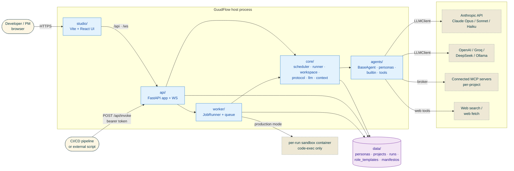

# 01 — System Context

A top-down view of GuudFlow as a deployed system. Boxes outside the dashed
boundary are actors or third-party services; everything inside is code in this
repository.

## Notes

- The **API** and **Worker** can run as one process (default — in-process
  worker, started by `api.main.lifespan`) or as two (set
  `GUUDFLOW_DISABLE_INPROC_WORKER=1`).
- `code-exec` is the only tool that crosses into the sandbox; every other
  tool runs in-process so file I/O can stay path-safe inside `FileWorkspace`.
- LLM calls always go through the runner-side `LLMClient` abstraction.
  Containers never see API keys (DESIGN §28).
- MCP and external HTTP go through the `CredentialsBroker`; agents never
  hold secrets.
