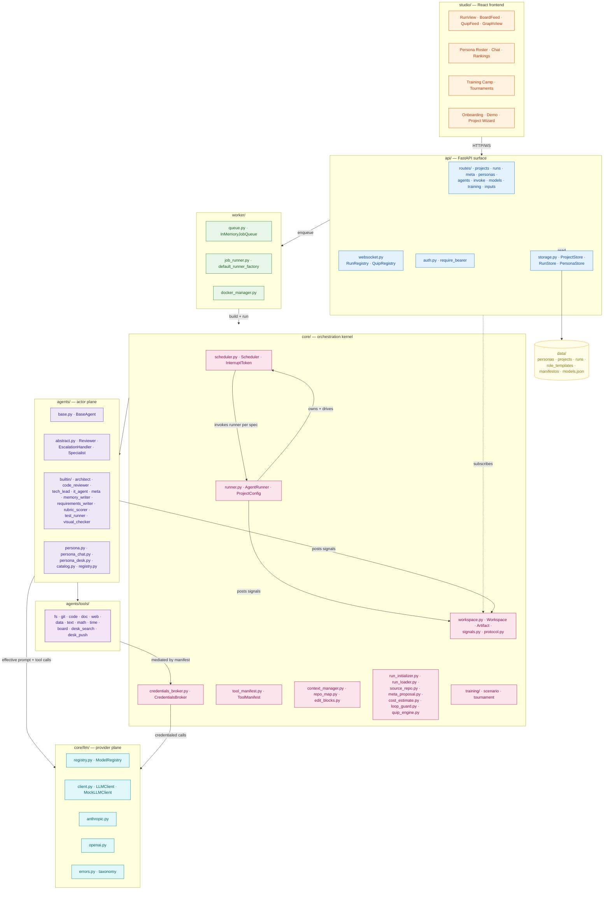

# 02 — Component Architecture

The layers inside the host process and the legal arrows between them. The
project follows the hard constraints in `CLAUDE.md` — most notably that the
**Scheduler owns concurrency**, the **Workspace is the only shared state**,
and **agents reach the outside world only through tools and the broker**.

## Legal arrows

| From | To | Allowed because |
|------|----|-----------------|
| API → Worker | enqueue / status | `api/routes/invoke.py` |
| Worker → Core | builds `AgentRunner` per job | `worker/job_runner.py` |
| Core → Agents | via `agents/registry.py` only | DESIGN §13 rule 4 |
| Agents → Tools | via `BaseAgent.call_tool()` only | DESIGN §31 rule 18 |
| Tools → Broker | for credentialed calls | DESIGN §30 rule 17 |
| Agents → Workspace | append-only signals | DESIGN §13 rule 3 |
| Scheduler → asyncio | sole owner of concurrency | DESIGN §13 rule 2 |

## Forbidden arrows

- Agents importing other agents directly — registry only.
- Anything outside `core/scheduler.py` calling `asyncio.gather` or
  `asyncio.create_task` for agent execution.
- Agents calling LLM provider SDKs directly — `LLMClient` only.
- Tools holding credentials — broker only.
