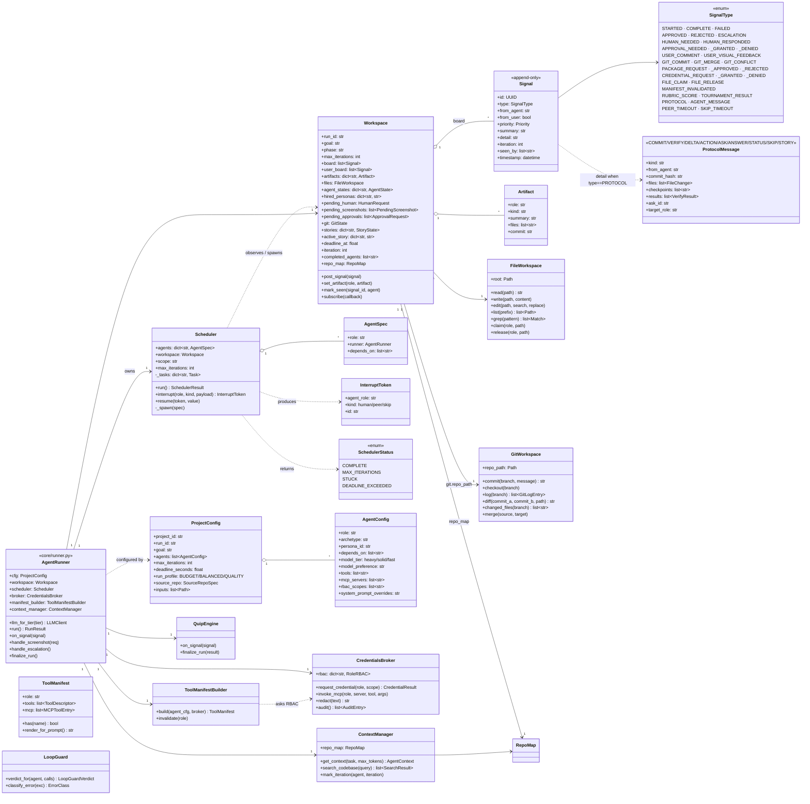

# 03 — UML Class Diagram: `core/`

The orchestration kernel. Everything an agent does flows through these
classes. Field lists are abridged to the public surface — see the source
modules for the full dataclasses.

## Key invariants encoded above

- `Workspace.board` is a `list[Signal]`, but only `post_signal` and
  `mark_seen` mutate it — append-only.
- `Scheduler.run()` is the single re-entry into orchestration; it returns a
  `SchedulerResult` keyed by `SchedulerStatus`.
- `AgentRunner` is the only object that holds references to *all* the
  shared singletons for a run (workspace, scheduler, broker, manifest
  builder, context manager, quip engine).
- `ToolManifest` is the per-agent runtime contract; agents call tools by
  name through it, never by direct import.
