# 04 — UML Class Diagram: `agents/`

The actor plane. `BaseAgent` is the universal contract. `Reviewer`,
`EscalationHandler`, and `Specialist` are the three abstract archetypes;
every builtin agent is a concrete subclass of one of them.

```mermaid
classDiagram
    direction TB

    class BaseAgent {
        +role: str
        +description: str
        +depends_on: list~str~
        +system_prompt: str
        +declared_local_tools: list~str~
        +declared_mcp_servers: list~str~
        +persona: Persona
        -_manifest: ToolManifest
        -_broker: CredentialsBroker
        -_context_manager: ContextManager
        -_llm: LLMClient
        -_scheduler: Scheduler
        -_manifesto: str
        -_project_rules: str
        -_project_context: str
        -_teammate_brief: str
        -_desk_index: DeskIndex
        +run(workspace) str
        +signal(type, summary, detail)
        +ask_human(question, context)
        +check_user_board(workspace) list~Signal~
        +request_visual_feedback(path, question)
        +request_package(name, reason)
        +emit_commit(...)
        +emit_verify(...)
        +emit_delta(...)
        +emit_action(...)
        +emit_ask(...)
        +emit_answer(...)
        +read_protocol(types) list~ProtocolMessage~
        +claim_files(paths)
        +release_files(paths)
        +call_tool(name, args)
        +request_credential(scope)
        +invoke_mcp(server, tool, args)
        +get_context(task, max_tokens) AgentContext
        +search_codebase(query) list~SearchResult~
        +recall(task) MemoryRecall
        +llm(messages, tools) LLMResponse
        +effective_system_prompt(brief) str
    }

    class Reviewer {
        <<abstract>>
        +emit_review(verdict, detail)
        +should_escalate(rejection_count) bool
    }

    class EscalationHandler {
        <<abstract>>
        +on_escalation(reviews) Decision
    }

    class Specialist {
        <<abstract>>
    }

    BaseAgent <|-- Reviewer
    BaseAgent <|-- EscalationHandler
    BaseAgent <|-- Specialist

    class Architect {
        +run(workspace)
    }
    class CodeReviewer {
        +run(workspace)
    }
    class TechLead {
        +run(workspace)
    }
    class ITAgent {
        +policy: PackagePolicy
        +run(workspace)
    }
    class MetaAgent {
        +propose(inputs) TeamProposal
    }
    class MemoryWriter {
        +synthesize(workspace) Episode
    }
    class RequirementsWriter
    class RubricScorer {
        +score(workspace, rubric) RubricResult
    }
    class TestRunner {
        +run_tests() VerifyResult
    }
    class VisualChecker {
        +request_screenshot(viewport)
    }

    Reviewer <|-- Architect
    Reviewer <|-- CodeReviewer
    EscalationHandler <|-- TechLead
    Specialist <|-- ITAgent
    Specialist <|-- MetaAgent
    Specialist <|-- MemoryWriter
    Specialist <|-- RequirementsWriter
    Specialist <|-- RubricScorer
    Specialist <|-- TestRunner
    Specialist <|-- VisualChecker

    class Registry {
        <<singleton, agents/registry.py>>
        +register(name, cls)
        +get(name) BaseAgent
        +has(name) bool
    }

    Registry ..> BaseAgent : produces

    class Persona {
        +profile: PersonaProfile
        +episodes: list~Episode~
        +patterns: list~Pattern~
        +antipatterns: list~AntiPattern~
        +style: WorkingStyle
        +reputation: Reputation
        +has_memory() bool
        +recall(task, limit) MemoryRecall
        +identity_layer() str
        +character_layer() str
        +stake_layer() str
        +log_history(entry)
    }

    class PersonaProfile {
        +id: str
        +name: str
        +archetype: str
        +model_preference: ModelPreference
        +goal: str
        +created_at: datetime
    }
    class Episode {
        +id: str
        +run_id: str
        +outcome: success/fail/rejected
        +files_touched: list~str~
        +patterns_applied: list~str~
        +score: float
    }
    class Pattern {
        +id: str
        +description: str
        +applies_when: list~str~
        +confidence: float
        +source_episodes: list~str~
        +state: emerging/active/declining/archived/superseded
    }
    class AntiPattern {
        +id: str
        +avoid: str
        +confidence: float
        +source_episodes: list~str~
    }
    class WorkingStyle {
        +tendencies: dict~str, float~
    }
    class Reputation {
        +production: ReputationBucket
        +training: TrainingReputation
    }
    class MemoryRecall {
        +patterns: list~RecalledPattern~
        +antipatterns: list~RecalledAntiPattern~
        +episodes: list~Episode~
        +render_for_prompt() str
    }

    Persona "1" --> "1" PersonaProfile
    Persona "1" o-- "*" Episode
    Persona "1" o-- "*" Pattern
    Persona "1" o-- "*" AntiPattern
    Persona "1" --> "1" WorkingStyle
    Persona "1" --> "1" Reputation
    Persona ..> MemoryRecall : produces

    BaseAgent --> Persona : optional

    class DeskIndex {
        +files: list~DeskFile~
        +search(tags, query) list~DeskFile~
        +render_inject_block(role, query) str
    }
    class DeskFile {
        +path: Path
        +tags: list~str~
        +front_matter: dict
        +body: str
    }
    DeskIndex "1" o-- "*" DeskFile
    BaseAgent --> DeskIndex : injected by runner
```

## Three abstract archetypes

| Archetype | Purpose | Builtins |
|-----------|---------|----------|
| `Reviewer` | reads work + emits APPROVED / REJECTED | `Architect`, `CodeReviewer` |
| `EscalationHandler` | fires only after a rejection threshold | `TechLead` |
| `Specialist` | does the work | everyone else |

## Persona = persistent specialist

A `Persona` exists across runs in `data/personas/{id}/` (six files —
`profile.json`, `episodes.jsonl`, `patterns.json`, `antipatterns.json`,
`style.json`, `reputation.json`, `history.json`). When an agent slot has
`persona_id` in its `AgentConfig`, the runner loads and binds a `Persona`
to the `BaseAgent` instance for that run; `effective_system_prompt()`
then injects the persona's identity / character / stake layers and the
contextually recalled memory.

## Agents never read raw memory

Agents call `recall(task)` and receive a `MemoryRecall`. Confidence and
relevance scoring (`compute_confidence`, `_tag_overlap`,
`_recency_weight`) are encapsulated inside `Persona`.
