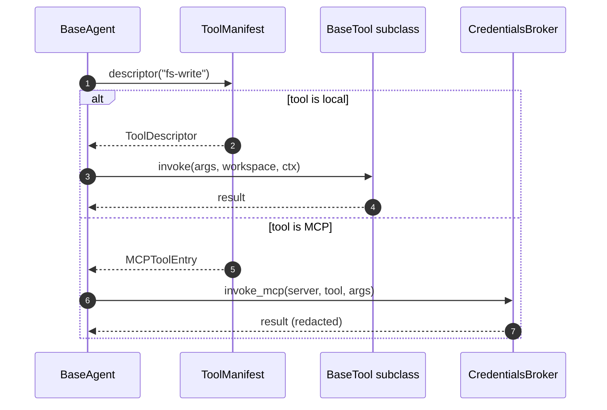

# 05 — UML Class Diagram: Tools + LLM Plane

Two parallel hierarchies that hang off `BaseAgent`:

- **Tools** — local, in-process, namespaced (`fs:*`, `git:*`, `code:*`,
  `web:*`, `doc:*`, `desk:*`, `board:*`). Mediated by `ToolManifest` so
  RBAC and MCP entries look the same to the agent.
- **LLM clients** — abstracted behind `LLMClient`, dispatched per agent
  by `ModelRegistry` based on tier + preference.

```mermaid
classDiagram
    direction LR

    class BaseTool {
        <<abstract>>
        +name: str
        +description: str
        +rbac_scope: str
        +spec() dict
        +invoke(args, workspace, context) str
    }

    class FsRead
    class FsList
    class FsExists
    class FsReadRange
    class FsGrep
    class FsWrite {
        <<claiming>>
    }
    class FsCreate {
        <<claiming>>
    }
    class FsEdit {
        <<claiming · SEARCH/REPLACE>>
    }
    class FsDelete {
        <<claiming>>
    }
    class FsRename {
        <<claiming>>
    }

    BaseTool <|-- FsRead
    BaseTool <|-- FsList
    BaseTool <|-- FsExists
    BaseTool <|-- FsReadRange
    BaseTool <|-- FsGrep
    BaseTool <|-- FsWrite
    BaseTool <|-- FsCreate
    BaseTool <|-- FsEdit
    BaseTool <|-- FsDelete
    BaseTool <|-- FsRename

    class GitDiff
    class GitChangedFiles
    class GitLog
    class GitStatus
    class GitRead

    BaseTool <|-- GitDiff
    BaseTool <|-- GitChangedFiles
    BaseTool <|-- GitLog
    BaseTool <|-- GitStatus
    BaseTool <|-- GitRead

    class CodeExec {
        <<sandbox in production>>
    }
    class CodeOutline
    BaseTool <|-- CodeExec
    BaseTool <|-- CodeOutline

    class WebSearch
    class WebFetch
    BaseTool <|-- WebSearch
    BaseTool <|-- WebFetch

    class DocRead
    class DocWrite
    BaseTool <|-- DocRead
    BaseTool <|-- DocWrite

    class DeskSearch
    class DeskPush
    BaseTool <|-- DeskSearch
    BaseTool <|-- DeskPush

    class BoardMessage {
        <<inter-agent AGENT_MESSAGE>>
    }
    BaseTool <|-- BoardMessage

    class TextTool
    class DataTool
    class MathTool
    class TimeTool
    BaseTool <|-- TextTool
    BaseTool <|-- DataTool
    BaseTool <|-- MathTool
    BaseTool <|-- TimeTool

    class ToolManifest {
        +role: str
        +tools: list~ToolDescriptor~
        +mcp: list~MCPToolEntry~
        +has(name) bool
        +descriptor(name) ToolDescriptor
        +render_for_prompt() str
    }

    class ToolDescriptor {
        +name: str
        +rbac_scope: str
        +description: str
        +schema: dict
    }

    class MCPToolEntry {
        +server: str
        +tool: str
        +rbac_scope: str
    }

    ToolManifest "1" o-- "*" ToolDescriptor
    ToolManifest "1" o-- "*" MCPToolEntry
    ToolDescriptor ..> BaseTool

    %% LLM plane
    class LLMClient {
        <<protocol>>
        +complete(messages, tools, system, cache_system) LLMResponse
        +stream(messages, tools)
    }

    class AnthropicLLMClient {
        +cache_system: bool
        +complete(...)
    }

    class OpenAILLMClient {
        +complete(...)
    }

    class MockLLMClient {
        +scripted_responses: list
    }

    LLMClient <|.. AnthropicLLMClient
    LLMClient <|.. OpenAILLMClient
    LLMClient <|.. MockLLMClient

    class LLMResponse {
        +text: str
        +tool_calls: list~ToolCall~
        +stop_reason: str
        +usage: dict
        +cache_read_tokens: int
        +cache_creation_tokens: int
    }
    class ToolCall {
        +id: str
        +name: str
        +input: dict
    }
    class LLMMessage {
        +role: user/assistant/tool
        +content: list
    }

    LLMClient ..> LLMResponse
    LLMResponse "1" o-- "*" ToolCall
    LLMClient ..> LLMMessage

    class ModelRegistry {
        +models: dict~str, ModelInfo~
        +providers: dict~str, ProviderInfo~
        +resolve(tier, preference) ModelInfo
        +client_for(model) LLMClient
        +cost_per_1k(model) tuple~float, float~
    }

    class ModelInfo {
        +id: str
        +tier: heavy/solid/fast
        +provider: str
        +cost_per_1k_input: float
        +cost_per_1k_output: float
        +deprecated: bool
    }

    class ProviderInfo {
        +name: str
        +base_url: str
        +api_key_env: str
        +supports_caching: bool
    }

    ModelRegistry "1" o-- "*" ModelInfo
    ModelRegistry "1" o-- "*" ProviderInfo
    ModelRegistry ..> LLMClient : caches per provider

    class LLMError {
        <<base>>
    }
    class RateLimitError
    class AuthError
    class ContextLengthError
    class InvalidRequestError
    class ServerError
    class NetworkError
    class TimeoutError

    LLMError <|-- RateLimitError
    LLMError <|-- AuthError
    LLMError <|-- ContextLengthError
    LLMError <|-- InvalidRequestError
    LLMError <|-- ServerError
    LLMError <|-- NetworkError
    LLMError <|-- TimeoutError

    LLMClient ..> LLMError : raises
```

## How an agent reaches a tool

## Hyphenated names everywhere

Tool names are hyphen-separated (`fs-write`, `git-diff`, `code-exec`,
`desk-search`). They map 1:1 to RBAC scope strings — see commit
`0709f1b refactor: hyphen-separated tool names + RBAC scopes`.
