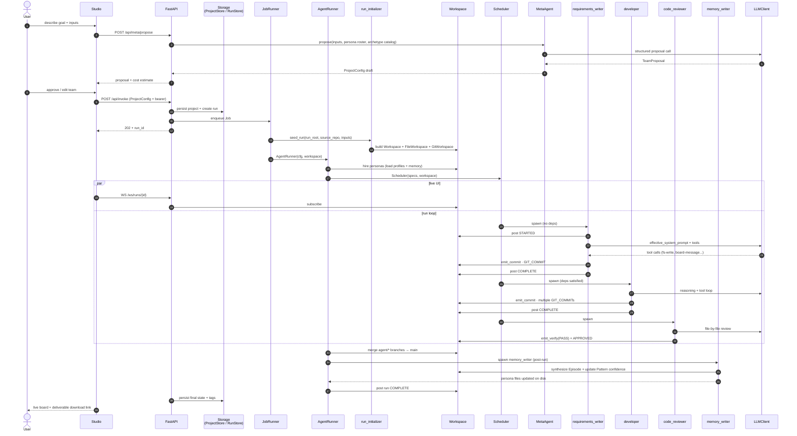

# 06 — Sequence: Run Lifecycle (Happy Path)

From "user submits a goal" through "deliverable bundle ready", with the
critical control points called out. The example uses a 3-agent team:
`requirements_writer → developer → code_reviewer` with `tech_lead` armed
for escalation.

## Variants

- **Rejection loop** — `Rev` posts REJECTED → `Runner` re-spawns `Dev`
  with `iteration += 1`. After `N` rejections (default `2`), the runner
  posts ESCALATION; `tech_lead` wakes up event-driven (no `depends_on`)
  and resolves.
- **Hard pause** — any agent calls `ask_human()`; this routes through
  `Scheduler.interrupt(role, "human", ...)`. New spawns are suspended
  but already-running agents finish their step. The runner posts
  `HUMAN_NEEDED`, the studio surfaces it, the user posts
  `HUMAN_RESPONDED`, the scheduler `resume()`s.
- **Resume after crash** — on Worker boot, `run_loader.restore_workspace`
  rehydrates `Workspace` from `data/runs/{run_id}/board.jsonl` and
  artifacts; the scheduler skips agents already in `completed_agents`.
- **Training mode** — `RubricScorer` replaces the human reviewer; runs
  feed `TournamentRegistry` instead of merging to main.

## Concurrency points

The diagram shows agents serially for clarity. In reality:

- **fan-out** — when `developer` and `architect` both depend only on
  `requirements_writer`, they are spawned concurrently by the same
  `_spawn` pass and run in their own `asyncio.Task`.
- **board fan-in** — every signal posted while agents run notifies
  WebSocket subscribers (`API` → `Studio`) live, in addition to the
  in-memory subscribers (`QuipEngine`, `RunRegistry`).
