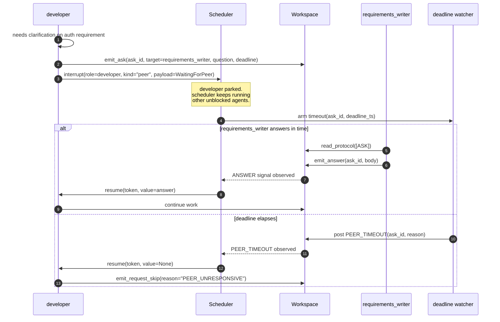
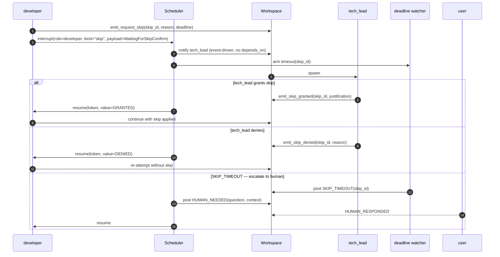
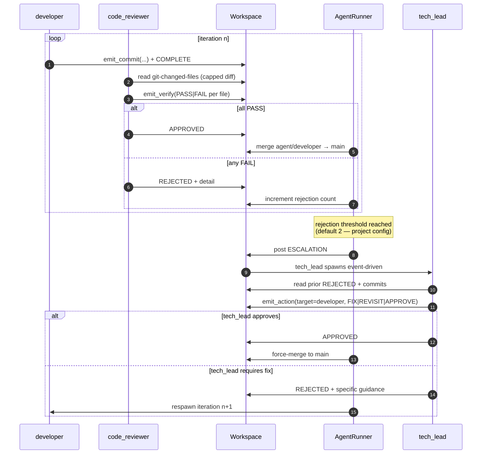

# 07 — Sequence: Handshake Protocol + Escalation

Two flows that show how the M1 inter-agent protocol and the multi-stage
review architecture cooperate:

1. **ASK / ANSWER handshake with peer-timeout** (asynchronous request to
   another agent without blocking the scheduler).
2. **Rejection escalation** to the on-call `tech_lead` after the
   threshold trips.

## 7a · ASK / ANSWER with timeout

Rules from `core/scheduler.py` and `core/protocol.py`:

- An agent may have **at most one outstanding ASK** at a time
  (one-outstanding-ASK guard).
- Allowed-speaker transitions are enforced by the scheduler — only the
  ASK target may emit the matching ANSWER (AutoGen-style).
- `AGENT_MESSAGE` (the post-autonomy fix from commit `d2cdfb1`) is the
  *non-blocking* sibling: it does not park the sender; the recipient
  picks the message up at the start of their next turn.

## 7b · REQUEST_SKIP escalation to tech_lead

## 7c · Review rejection escalation

## Why event-driven `tech_lead` and `IT` are not in `depends_on`

The pipeline DAG is for ordinary work. `tech_lead`, `it_agent`, and
`memory_writer` wake on **signals** (`ESCALATION`, `PACKAGE_REQUEST`,
end-of-run) — not on dependency completion. They are registered as
agents but are filtered out of the topological closure when the
`Scheduler` decides what is "unblocked" by `completed_agents`.
