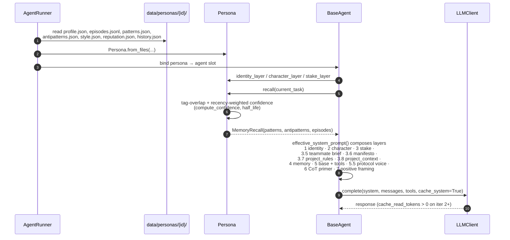
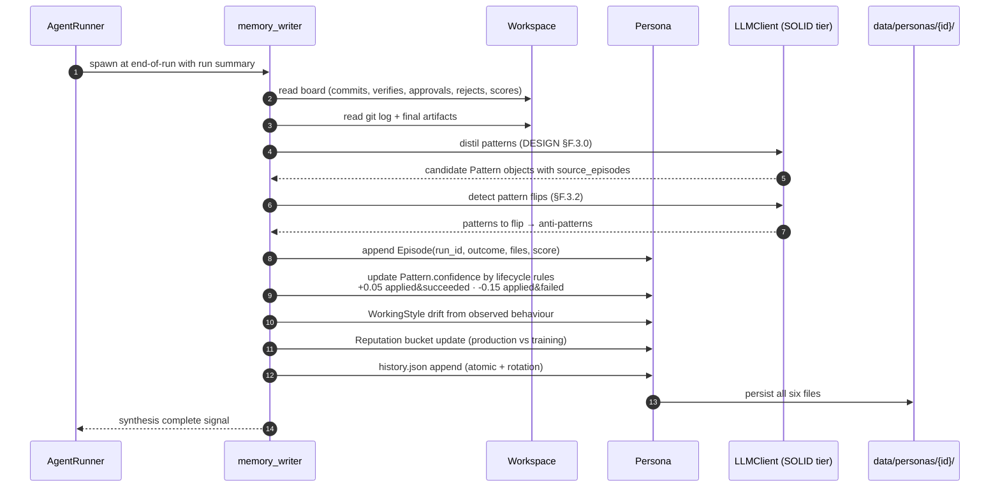
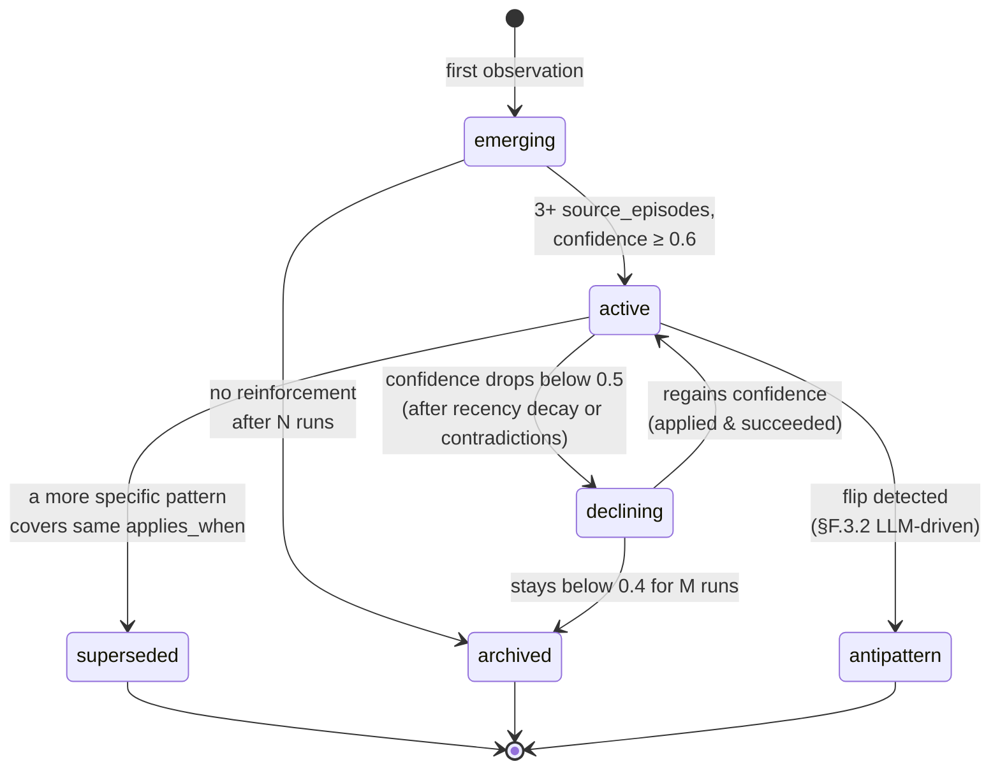
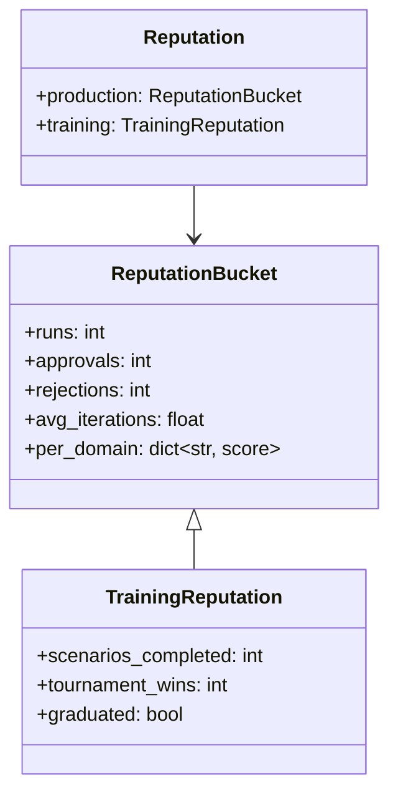

# 08 — Sequence: Persona Memory Lifecycle

The three-layer memory model from DESIGN §26 / §34, end-to-end. Memory is
**dynamic, not append-only-forever**: patterns have lifecycle states,
confidence is recency-weighted, and reconciliation runs after every run.

## 8a · Memory injection at run start

The system prompt is sent with `cache_system=True`. Because the stable
layers (identity, character, manifesto, project rules, project context,
base prompt, tool catalog, primers) come **before** the volatile layer
(recalled memory + current task), the Anthropic prompt cache hits on
every iteration after the first.

## 8b · Post-run synthesis (memory_writer)

## 8c · Pattern lifecycle states

States are stored on `Pattern.state`. Confidence is decayed using a
recency half-life (90d default — see `compute_confidence` in
`agents/persona.py`).

## 8d · Two reputation buckets, one episode log

Production runs and training runs **share** `episodes.jsonl` (the raw
truth) but **split** the reputation buckets. Graduation is a soft gate
in the studio — it does not lock the persona out of production.
