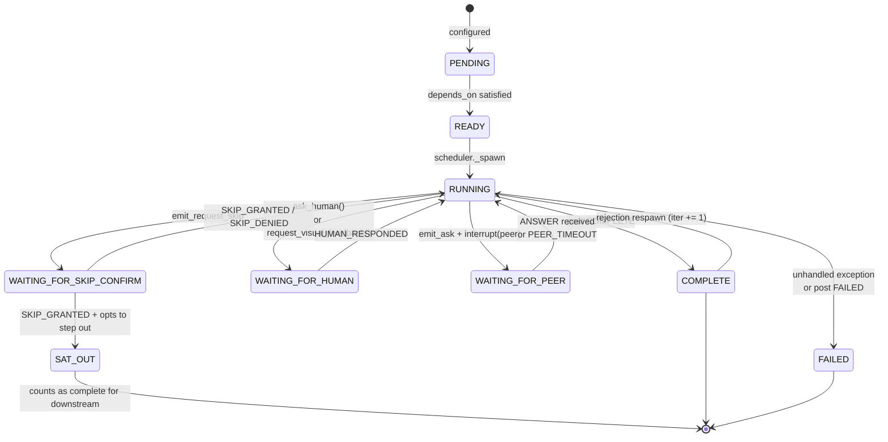
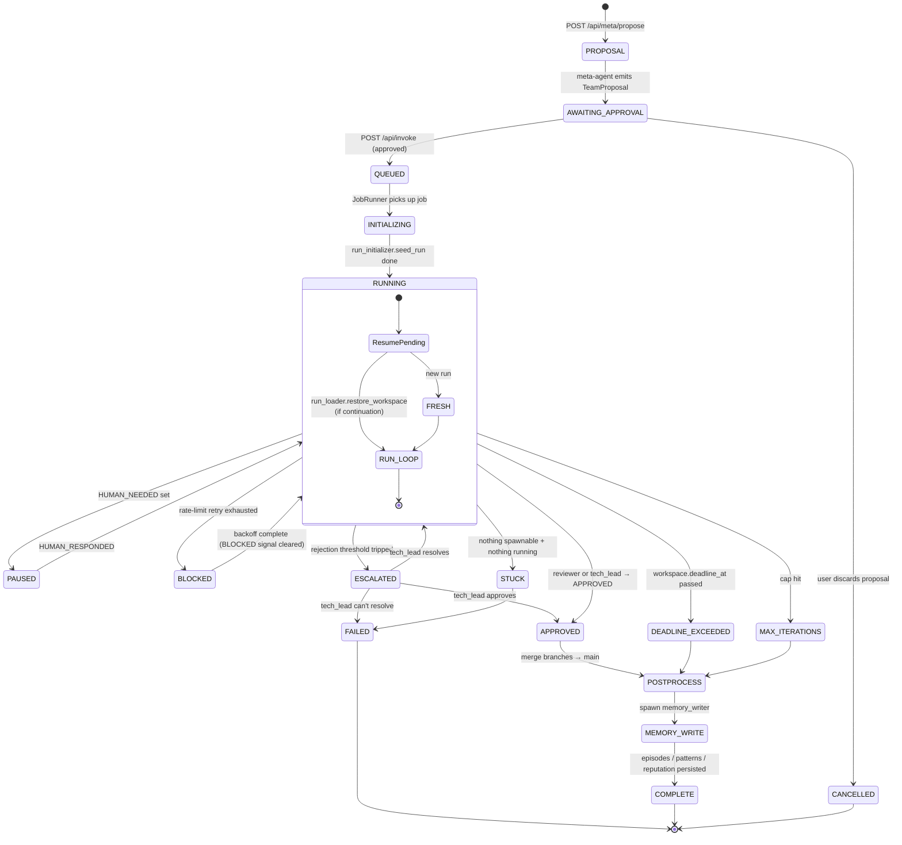
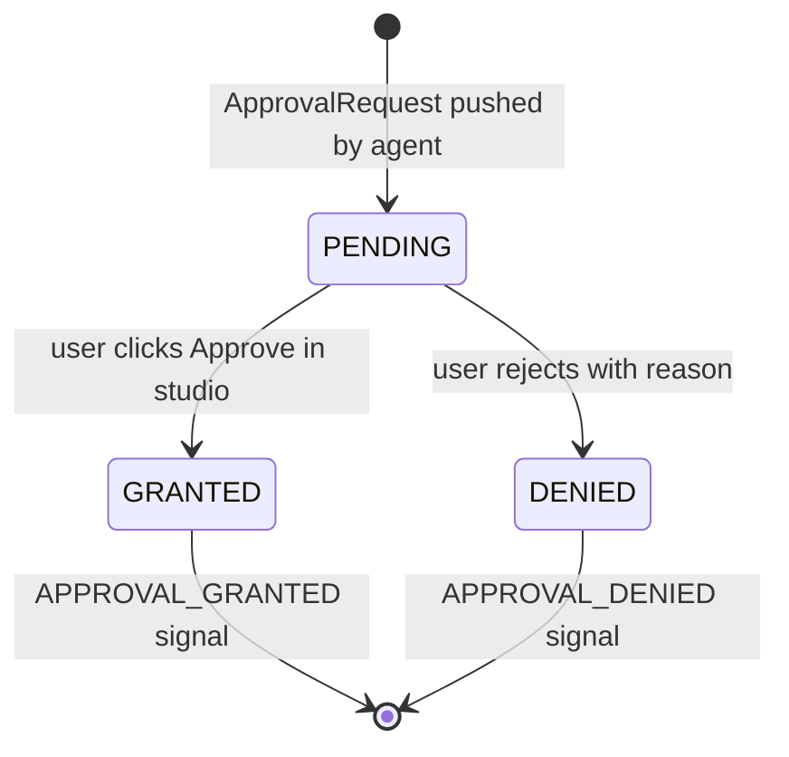

# 09 — State Diagrams: Agent + Run

Two finite-state machines that drive scheduler decisions. The states here
are the **observable** states tracked in `Workspace` — internal
asyncio.Task state is not modelled because the scheduler is the only
thing that needs to know about it.

## 9a · Agent state machine

The values come straight from `core/workspace.py::AgentState`.

### Notes

- A `COMPLETE` agent can be respawned for another iteration after a
  reviewer posts `REJECTED`. The runner increments `iteration` and the
  scheduler treats it as a fresh `READY → RUNNING` transition.
- `SAT_OUT` is a successful skip — the agent never produced an artifact
  but its dependents proceed. Used for "allow developer to skip
  documentation when tech_lead grants it."

## 9b · Run state machine (top-level orchestration)

### Notes

- `BLOCKED` is the rate-limit/backoff state added in commit `ad9a78d`.
  The runner posts a `BLOCKED` signal so the studio shows a banner; the
  agent's `asyncio.Task` is sleeping, not torn down.
- `DEADLINE_EXCEEDED`, `MAX_ITERATIONS`, and `STUCK` are the three
  "abnormal but graceful" terminals from `SchedulerStatus`. All of
  them still trigger memory writing — partial runs produce partial
  episodes.
- A run that **resumes** after a worker crash starts in `INITIALIZING`,
  but inside the state node `ResumePending` branches to the
  loader path so completed agents are not re-run (Phase G-prime).

## 9c · Approval gate (per-deliverable)

Approval gates exist independently of reviewer agents — a user can be
inserted into the loop on any phase change. See
`workspace.pending_approvals`.
