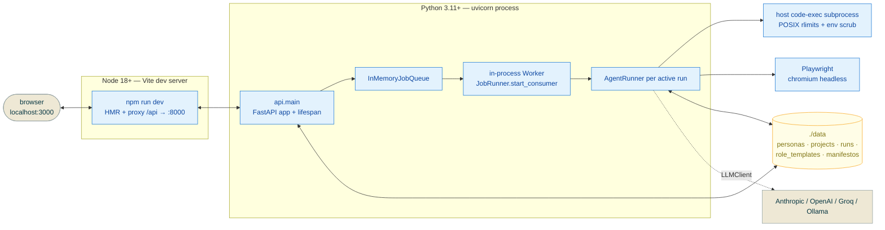
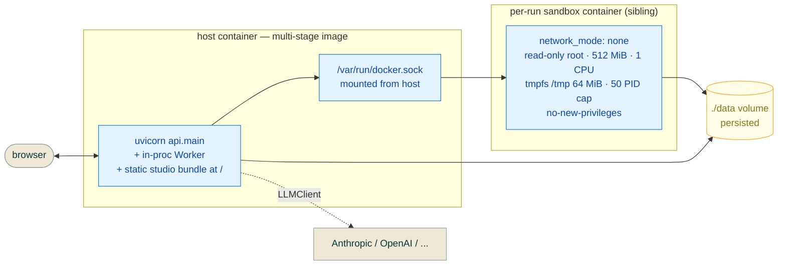
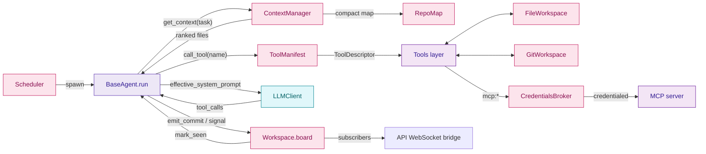

# 10 — Deployment + Data Flow

How the boxes from diagrams 01–02 actually run, and what flows between
them at runtime.

## 10a · Local dev deployment (default)



Key points:

- `GUUDFLOW_MODE=dev` (default) — `code-exec` runs on the host with
  hardening (audit log, env scrub, cwd pin, POSIX rlimits, mode
  enforcement). Logs a warning every invocation per CLAUDE.md.
- Worker runs **in-process** so a single `uvicorn` command boots the
  whole backend. Set `GUUDFLOW_DISABLE_INPROC_WORKER=1` to split.

## 10b · Docker compose (host + per-run sandbox)



- The host container does **not** run sandboxes nested. Sandboxes are
  spawned as **siblings** through the mounted Docker socket (see
  ROADMAP.md k8s notes for the production migration plan).
- `code-exec` is the only tool routed through `DockerManager.exec_in()`.
- API keys live in the host environment, never in sandbox containers.

## 10c · Data flow during a single iteration



## 10d · On-disk run layout

```
data/
├── personas/{persona_id}/
│   ├── profile.json
│   ├── episodes.jsonl          ← append-only, raw truth
│   ├── patterns.json           ← lifecycle states · confidence
│   ├── antipatterns.json       ← flips from patterns
│   ├── style.json              ← drifted tendencies
│   ├── reputation.json         ← split: production + training
│   └── history.json            ← rotated to history.archive.jsonl @1000
│
├── projects/{project_id}/
│   ├── project.json            ← ProjectConfig
│   ├── persona_rules/          ← project rules per persona (DESIGN §36)
│   │   ├── _shared.md
│   │   └── {persona_id}.md
│   ├── manifesto.md            ← Layer 3.6
│   ├── roadmap.md              ← Layer 3.8 (Phase K)
│   └── inputs/                 ← read-only at runtime
│
├── runs/{run_id}/
│   ├── workspace.json          ← serialised Workspace
│   ├── board.jsonl             ← incremental signal log (Phase G-prime.0)
│   ├── artifacts/{role}/...
│   ├── working/                ← live workspace + .git/
│   ├── inputs/README.md        ← generated per-run by run_initializer
│   ├── screenshots/...
│   └── deliverables.zip
│
├── role_templates/{archetype}/
│   └── desk/*.md               ← persona-desk seed templates (M2)
│
├── manifestos/default.md       ← office-wide rules of engagement
├── models.json                 ← ModelRegistry source
└── training_camp/scenarios/{name}/
    ├── scenario.yaml
    └── rubric.yaml
```
